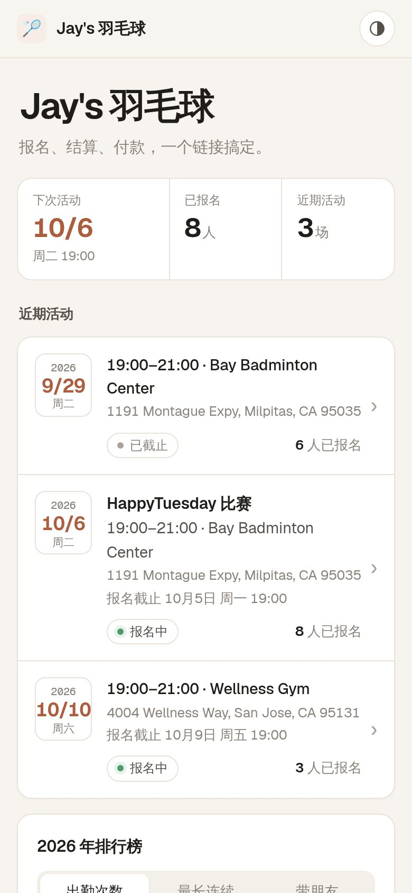
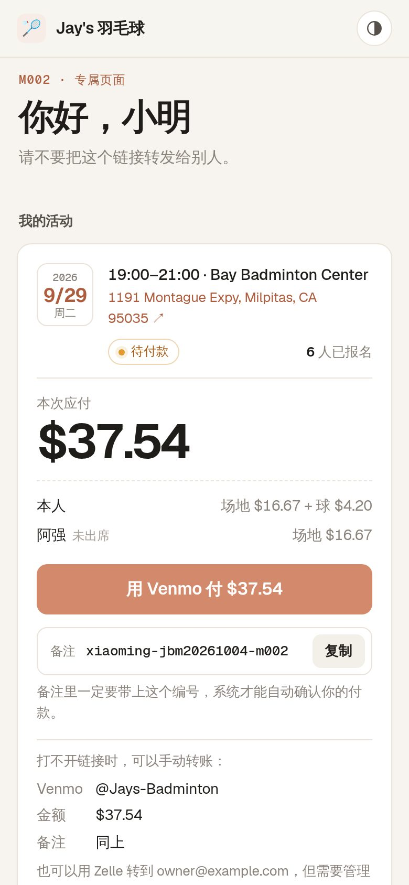
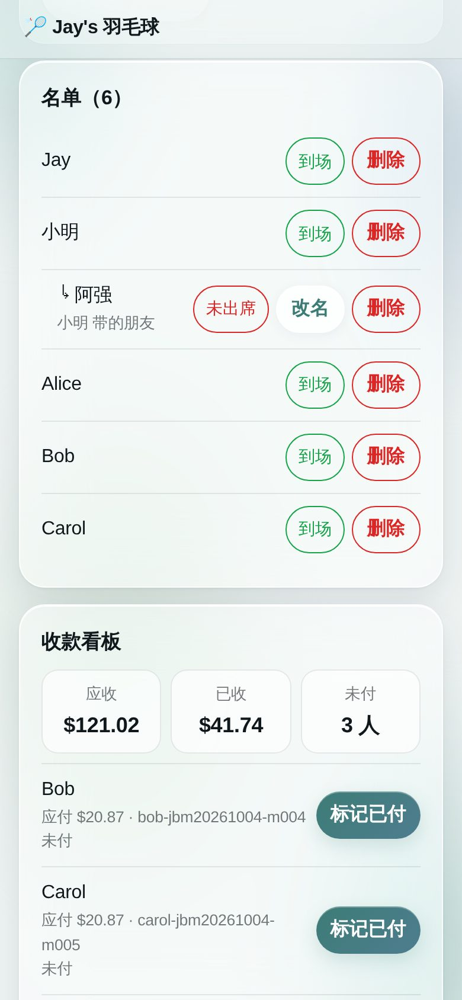
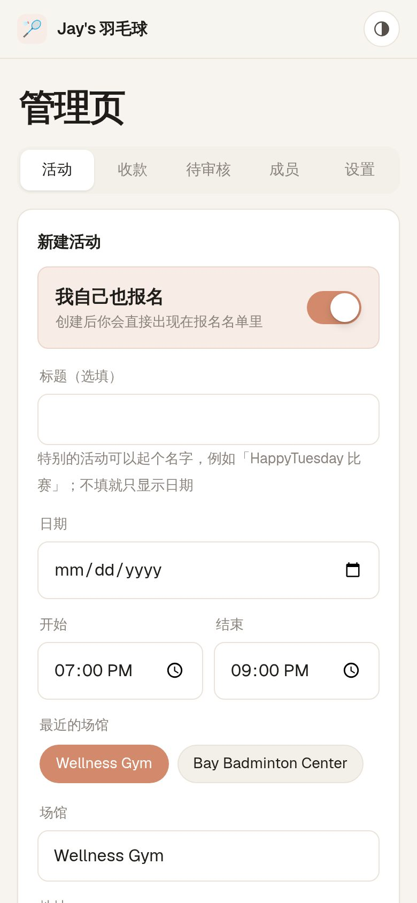
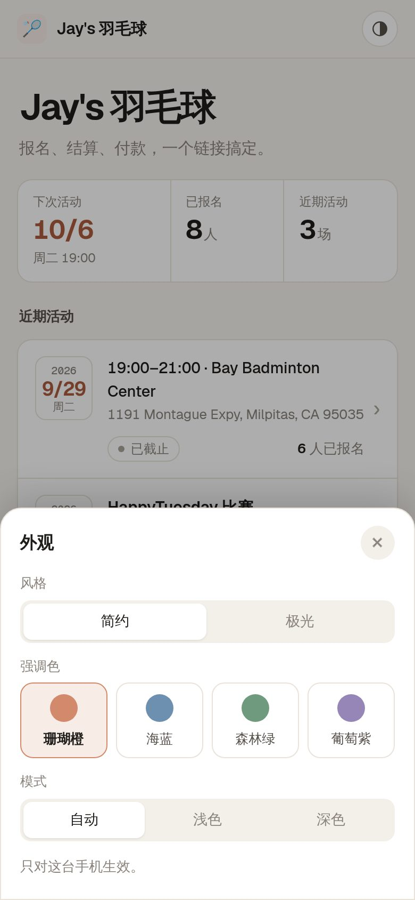
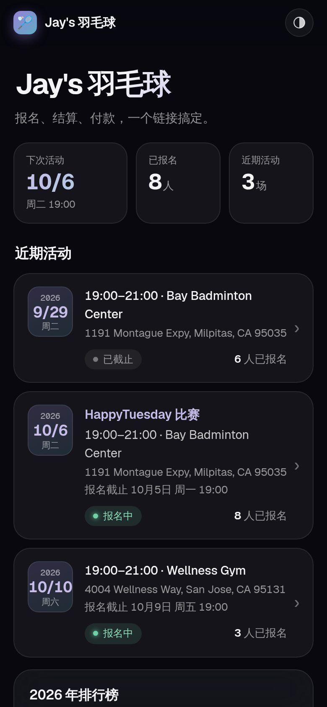
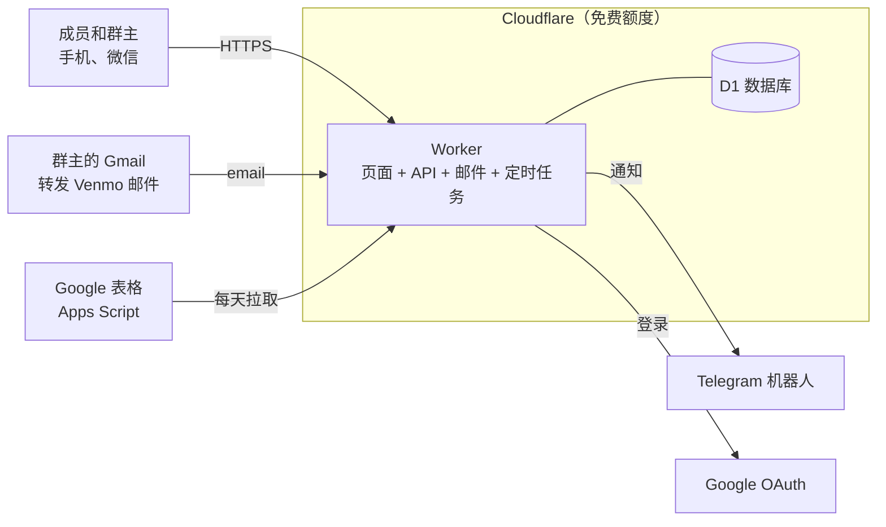

# Jay's 羽毛球 · Jay's Badminton

一个羽毛球群的报名和收费网站。成员在手机上报名、带朋友、看名单；活动结束后群主填上场地费和用球数，系统自动算出每人该付多少，成员点一下就能用 Venmo 付款，Venmo 的收款邮件转发进来以后会自动对账、自动标记已付。群主不用再在微信群里接龙、对着计算器分账、翻 Venmo 记录核对谁付了没有。

A sign-up and fee-collection site for a weekly badminton group (about 50 members, 20–30 per session), built on Cloudflare's free tier.

- **正式网站**：https://jaysbadminton.llmat.dev
- **测试网站**：https://staging.jaysbadminton.llmat.dev（顶部有黄色「测试环境」横幅，数据和正式网站分开）

<table>
  <tr>
    <td align="center"><br><sub>公开首页：近期活动和排行榜，不显示名单和金额</sub></td>
    <td align="center"><br><sub>成员页面：账单明细，一键 Venmo 付款</sub></td>
    <td align="center"><br><sub>管理页：到场标记和收款看板</sub></td>
  </tr>
  <tr>
    <td align="center"><br><sub>新建活动：常用场馆、地址联想</sub></td>
    <td align="center"><br><sub>每个人自己选外观</sub></td>
    <td align="center"><br><sub>极光风格 · 深色</sub></td>
  </tr>
</table>

截图用的是演示数据，人名、场馆和账号都是虚构的。

---

## 一、项目特色

**报名不用接龙**
- 成员用 Google 账号登录（或群主私发的专属链接），点「报名」，可以带朋友并写上朋友的名字。
- 报了名的人能看到完整名单（包括谁带了谁）；公开页面和微信分享卡片只显示人数，从不显示名字。
- 一键加入 iPhone / Outlook / Google 日历，提前 2 小时提醒。
- 报名中的活动可以生成分享名片：一张带日期、时间、场馆和二维码的图片（不含名字），长按保存后发到微信群；首页也能生成整个网站的名片。

**算账不用计算器**
- 群主勾选谁到了场，输入场地总费用、用球个数和单价，系统按规则算出每个人的金额：场地费所有报名的人平摊，球费到场的人平摊，带的朋友算在带他的人账上。
- 金额全部用整数「分」计算并向上取整，不会因为小数误差少收钱；可以先预览再确认。

**收款不用对账**
- 每个人的付款页面有一个预填好收款人、金额和备注编号的 Venmo 按钮。
- 群主的 Gmail 把 Venmo 的收款邮件转发给网站，网站校验 Venmo 的数字签名后按备注编号自动标记已付；部分付款、多付要退款、编号写错的都会单独列出来让群主确认。
- 每一笔付款和退款都单独记录：多付的钱列在「需要退款」里，群主退款后点「已退款」记一笔退款；Finalize 后改了费用，已付款的人会显示还差多少或多付多少。
- 所有人付清后自动归档，并给群主发一条带明细的收齐消息。

**通知到 Telegram**
- 截止前提醒、报名截止那一刻的名单、活动结束后提醒结算、每天的催款提醒、收齐存档、每周健康简报。
- 每条通知里都附好了可以直接复制到微信群的文字。

**每个人自己的页面**
- 「我的活动」：自己报名的活动从新到旧排列，已经结束并付清的折叠进「历史活动」。
- 「个人信息」：花费图表（可选 7 天到全部的时间范围）、GitHub 式的参加热力图、入群时间和联系邮箱。
- 两种外观风格 × 4 种强调色，支持深色模式，每个人自己选。

**零成本、好维护**
- 全部运行在 Cloudflare 免费额度内（Workers + D1 数据库 + 定时任务 + 邮件路由），唯一的花费是域名。
- 改动先自动部署到测试网站，确认没问题再打版本标签发布到正式网站；发布前自动备份数据库，出问题可以回滚代码，但不能早于最近一次新增数据库迁移的版本（见下方「回滚的限制」）。
- 每天自动把数据同步一份到群主自己的 Google 表格。

---

## 二、用户指南

### 成员

1. **加入**：打开网站首页，点「登录 / 注册」，选「用 Google 登录 / 注册」或「用邮箱注册」，填用户名和微信名（群昵称或微信号都行），也可以给群主留言；用邮箱注册还要填两次邮箱。群主审核通过后就能报名：用 Google 的直接登录，用邮箱的会收到专属链接的邮件（链接丢了可以点「找回我的专属链接」再要一次）。
2. **报名**：在首页点一个活动，或在「我的活动」的「可以报名」里点「报名」。可以带朋友（有上限），截止前随时修改或取消。
3. **看名单**：报名以后，活动卡片上能看到所有报名的人。
4. **付款**：活动结算后，「我的活动」里会出现本次应付金额。点「用 Venmo 付」，**备注里的编号不要删**，系统靠它自动对账。在微信里打不开 Venmo 时，按提示「在浏览器中打开」。
5. **我的活动和个人信息**：点右上角头像，可以进入「我的活动」「个人信息」，或者退出登录。用专属链接的成员，点页面上方的「个人信息」，也可以在那里绑定 Google 账号，以后直接用 Google 登录。

### 群主

| 要做的事 | 在哪里 |
| --- | --- |
| 第一次设置 | 打开 `/admin`，输入群主密码，收藏生成的管理链接。然后在「设置 → 用 Google 登录管理页」绑定自己的 Google 账号，以后用 Google 登录就能直接进管理页 |
| 审核新成员 | 「待审核」→ 通过 / 拒绝。用 Google 申请的人通过后自己登录即可；用邮箱注册的人会自动收到专属链接的邮件（失败时可在成员列表重试，或把链接私发给对方） |
| 管理成员 | 「成员」：点名字看个人信息、加只有自己能看到的备注名；停用、恢复、删除（删除后名字可以给新人用，旧记录显示为「名字（编号）」） |
| 建活动、自己报名 | 「活动 → 新建活动」。自己打球在活动详情的「我的报名」里报名，不受带朋友上限限制 |
| 改名单 | 活动详情：代加临时人员、删除（有人顶替就删掉原报名者再加顶替者）；立即截止、重新开放、修改时间地点 |
| 结算 | 活动结束后：标记谁没到场 → 输入场地费、用球数和单价 → 预览每人金额 → Finalize |
| 收款 | 「收款」看板自动更新；「待确认」里处理对不上的付款；也可以手动标记已付、记录退款 |
| 通知 | 「设置 → 连接 Telegram」。给机器人发「管理页面」可以找回管理链接 |
| 其他设置 | 收款账号（加锁）、带朋友上限、提醒时间、默认外观、网站标题、排行榜开关、导出 CSV、Google 表格同步、备份网站密钥（存成 GitHub secret，见下面「部署配置」） |

管理页里的「使用指南」有逐项打勾的上线清单，第一次设置时照着走一遍即可。

### 网站维护者

- **发布**：改动合并到 `main` 后自动部署到测试网站。测试没问题后，在 GitHub → Actions → **Release** → Run workflow（分支选 `main`，发布说明可选填），或者直接让 Claude「发布」。它会给 `main` 打上当天的 `vYYYY.MM.DD` 标签（同一天再发加 `.2`）、发布 Release（自动附上合并的 PR 列表），然后先备份正式数据库再部署到正式网站。`main` 的 CI 没通过、或者这个提交已经发布过时会拒绝发布。也可以照旧在 GitHub → Releases 手动新建标签发布。
- **回滚**：Actions → CI → Run workflow，「Use workflow from」选上一个版本标签。只能回滚到 migrations 文件夹里已经包含数据库执行过的全部迁移的版本，也就是不早于最近一次新增迁移的那个版本（在那个标签上 `ls migrations/` 就能看到它带了哪些迁移），原因见下面「回滚的限制」。
- **忘记群主密码**：修改 GitHub secret `ADMIN_PASSWORD`（测试网站是 `ADMIN_PASSWORD_STAGING`），再按上面的方法重新部署一次。
- **丢了管理链接**：已绑定 Google 的话直接用 Google 登录；或者在 Telegram 给机器人发「管理页面」；或者运行一次部署并勾选 `reset_admin_link`（正式网站选最新版本标签，测试网站选 `main`），然后回到 `/admin` 重新设置。数据不受影响。
- 上线前要在真实手机和账号上确认的事项见 [docs/launch-checklist.md](docs/launch-checklist.md)。

---

## 三、技术架构



一个 Cloudflare Worker 同时提供网页、JSON API、接收转发的 Venmo 邮件，并每 15 分钟运行一次定时任务（报名截止由每个活动自己的闹钟准时触发），所有数据都在一个 D1（SQLite）数据库里。

| 部分 | 选择 |
| --- | --- |
| 前端 | Preact + Vite，中文界面，手机优先，没有 CSS 框架（照顾微信内置浏览器） |
| 后端 | Hono，运行在 Cloudflare Workers 上 |
| 数据库 | Cloudflare D1，`migrations/` 里按编号的 SQL 迁移 |
| 登录 | Google OAuth（Authorization Code + PKCE）；或每人一个随机令牌的专属链接；管理页是管理链接 + 密码，或群主绑定的 Google 账号 |
| 邮件 | Cloudflare Email Routing → Worker，自己校验 Venmo 的 DKIM 签名，`postal-mime` 解析 |
| 通知 | Telegram Bot API |
| 测试 | Vitest（在 Workers 运行时里跑，连本地 D1）+ Playwright 浏览器测试 |
| 部署 | GitHub Actions：PR 跑检查；合并到 `main` 部署测试网站；`v*` 标签部署正式网站 |

### 一些设计要点

- **隐私**：公开页面只显示人数；令牌在数据库里只存哈希和加密后的密文；导出和表格同步从不包含令牌。一个 Google 账号只能对应一个人。
- **算钱**：结算是一个纯函数 `settle()`，预览和 Finalize 共用，全程整数「分」并向上取整，有单元测试覆盖需求文档里的例子。
- **付款编号**：形如 `xiaoming-jbm20261006-m007`，中间是活动编号（创建活动时生成，之后改日期也不变，也不会再分配给别的活动），对账认活动编号和成员编号，改名不影响。
- **自动对账**：只接受签名有效的 Venmo 邮件；金额对上就标记已付，部分付款和多付会通知群主；伪造的邮件在签名校验这一步就被丢弃。
- **截止闹钟**：每个活动一个 Durable Object（`src/worker/deadlines.ts`），闹钟定在「截止前提醒」和截止那一刻，到点关闭报名并发出「报名截止」。创建、编辑、提前截止、重新开放、取消活动以及修改提醒设置时都会重新设定闹钟，定时任务每次运行也会为所有报名中的活动重设一遍（上线前已有的活动也就有了闹钟）。
- **定时任务**：每 15 分钟运行，负责结算提醒、每日催款、Gmail 转发检查和每周汇总，同时兜底补发闹钟漏掉的截止通知；每条通知都记录在 `notification_log` 里，重试也不会重复发送。
- **归档**：所有人付清后活动变为「已收齐」，之后不能再修改；状态转换在每个接口里都会检查。

### 目录

| 路径 | 内容 |
| --- | --- |
| `src/worker/` | Worker：Hono API、Google 登录、定时任务、邮件处理、结算、Telegram |
| `src/web/` | Preact 前端（Vite 构建到 `dist/web`，作为静态资源提供） |
| `src/shared/` | 前后端共用：类型、结算、时间、外观、日历、花费统计 |
| `migrations/` | D1 数据库迁移 |
| `test/`、`e2e/` | 单元 / 集成测试，浏览器测试 |
| `scripts/` | CI 用的脚本：查找或创建 D1、同步 secrets、冒烟测试、本地测试服务器 |
| `docs/` | 需求文档、技术设计、Google 登录配置、上线检查清单 |

### 本地开发

需要 Node.js 22。

```sh
npm install
npm run db:migrate:local      # 建本地 D1 数据库
printf 'TOKEN_KEY="dev"\nADMIN_PASSWORD="dev-password"\n' > .dev.vars
npm run dev                   # 构建前端并在 http://localhost:8787 启动
npm test                      # 单元测试
npm run test:e2e              # 浏览器测试（在本地 Worker 上用全新的数据库）
npm run typecheck
npm run lint                  # Biome 检查（CI 也会跑）
npm run format                # Biome 自动格式化并修复
```

### 部署配置

| | 地址 | 什么时候部署 | 数据库 |
| --- | --- | --- | --- |
| 测试网站 | https://staging.jaysbadminton.llmat.dev | 每次合并到 `main` | `jaysbadminton-staging` |
| 正式网站 | https://jaysbadminton.llmat.dev | 推送 `vYYYY.MM.DD` 标签 | `jaysbadminton` |

每次部署会找到或创建对应的 D1 数据库、执行迁移、`wrangler deploy`、同步 secrets，并从外部冒烟测试一遍。正式部署会拒绝不在 `main` 上的标签，并先把数据库导出为 Actions 的附件（保留 90 天）。

**回滚的限制**：回滚只换代码，不会撤销已经执行的数据库迁移，而旧代码不认识它之后的迁移带来的数据。例如 `0018` 之前的代码点「已退款」只改 `refunded_cents`、不记退款记录；再升级回来时，已收和已退金额按收款记录重新计算，这笔退款就没了，这个人又出现在「需要退款」里，可能被退两次。`0021` 之前的代码新建活动时没有活动编号，再升级回来后这些活动的付款编号会变成 `名字-null-m007`，Venmo 对不上账。所以只能回滚到 migrations 文件夹里已经包含数据库执行过的全部迁移的版本，也就是不早于最近一次新增迁移的那个版本（在那个标签上 `ls migrations/` 就能看到它带了哪些迁移）。确实需要更早的版本时，先用目标版本之后第一次新增迁移的那次发布之前的数据库备份（那次发布的 Actions 运行里的 Artifacts，只保留 90 天）恢复数据库，再部署那个版本：备份是 `wrangler d1 export` 导出的 SQL，要先清空正式网站用的那个 `jaysbadminton` 数据库再导入（部署按这个名字找数据库），并且会丢掉备份之后的所有报名、付款和设置改动。`v2026.10.03.4` 之前的标签没有活动闹钟（Durable Object），Cloudflare 会拒绝部署，不要回滚到它们。

GitHub 仓库需要的 secrets：

| Secret | 说明 |
| --- | --- |
| `CLOUDFLARE_ACCOUNT_ID`、`CLOUDFLARE_API_TOKEN` | Cloudflare 账号和 API 令牌（Workers 编辑 + D1 编辑权限） |
| `ADMIN_PASSWORD` | 正式网站的初始群主密码，也是忘记密码时的重置方法 |
| `ADMIN_PASSWORD_STAGING` | 测试网站的群主密码（不设置时沿用 `ADMIN_PASSWORD`） |
| `TELEGRAM_BOT_TOKEN`、`TELEGRAM_BOT_TOKEN_STAGING` | 两个 Telegram 机器人（一个机器人只能有一个 webhook），可选 |
| `GOOGLE_CLIENT_ID`、`GOOGLE_CLIENT_SECRET` | Google 登录，可选；配置方法见 [docs/google-login.zh.md](docs/google-login.zh.md) |
| `TELEGRAM_DEV_BOT_TOKEN`、`TELEGRAM_DEV_CHAT_ID` | 可选：开发群通知。每个 PR 合并、每次正式发布（成功或失败）都发一条消息到开发者的 Telegram 群。用一个单独的机器人，不要用网站的机器人 |
| `GOOGLE_MAPS_API_KEY` | 地址联想，可选；没有时使用免费的 Photon |
| `RESEND_API_KEY`、`EMAIL_FROM` | 用邮箱注册的成员审核通过后自动发链接邮件、找回链接，可选 |
| `LINK_ENCRYPTION_KEY`、`LINK_ENCRYPTION_KEY_STAGING` | 正式网站和测试网站 `TOKEN_KEY` 的备份。在管理页「设置 → 备份网站密钥」把密钥发到 Telegram 后存进来。每次部署都会核对它。核对在 `wrangler deploy` 之后进行，对不上时这次部署任务会失败，但新版本已经上线，后面的 `reset_admin_link` 步骤和冒烟测试也不会运行；万一 Worker 的 `TOKEN_KEY` 丢了，部署时自动用它填回去 |

每个网站的 `TOKEN_KEY` 由 CI 在第一次部署时自动生成，之后不再更换（它加密保存成员链接、管理链接和 Google 表格同步的密钥，群主密码的哈希也由它派生；丢了的话，成员链接无法再显示或通过邮件找回（只能重新生成），Telegram 找回管理链接时会换一个新的，群主密码会被重置，Google 表格同步要重新生成密钥并粘贴新脚本）。Cloudflare 里看不到它的值，所以要用上面的 `LINK_ENCRYPTION_KEY` 备份。

### 文档

| 文档 | 内容 |
| --- | --- |
| [docs/requirements.zh.md](docs/requirements.zh.md) | 需求文档：业务规则、页面、费用计算、对账、通知 |
| [docs/technical-design.md](docs/technical-design.md) | 技术设计（英文）：架构、数据表、API、邮件处理、定时任务、部署 |
| [docs/google-login.zh.md](docs/google-login.zh.md) | Google 登录：OAuth 配置、成员和群主的使用方式 |
| [docs/launch-checklist.md](docs/launch-checklist.md) | 上线检查清单：交接、首次设置、真实环境验证、日常维护、打开组织者功能 |

### 测试站开发者登录

测试站的 `/login` 页面提供「开发者登录」，密码为测试环境当前的群主密码（初始来自 `ADMIN_PASSWORD_STAGING`）。成功后进入一个专用、已批准且没有群主身份的测试成员账号。左下角「开发者 · 切换界面」菜单可进入 `/admin/developer` 群主界面或 `/me` 普通用户界面，并可退出开发者登录。

该入口和权限由服务端 `ENVIRONMENT=staging` 限定，正式环境一律拒绝开发者接口。会话为 HttpOnly、SameSite=Strict，8 小时过期；退出、重置测试数据或修改群主密码都会使会话失效。普通视图的报名等操作会写入测试数据库，群主视图也是真实操作测试数据，不是静态演示。

测试站页面 logo 和标签 favicon 使用相同桥形图案的紫色配色，方便区别于正式站。
