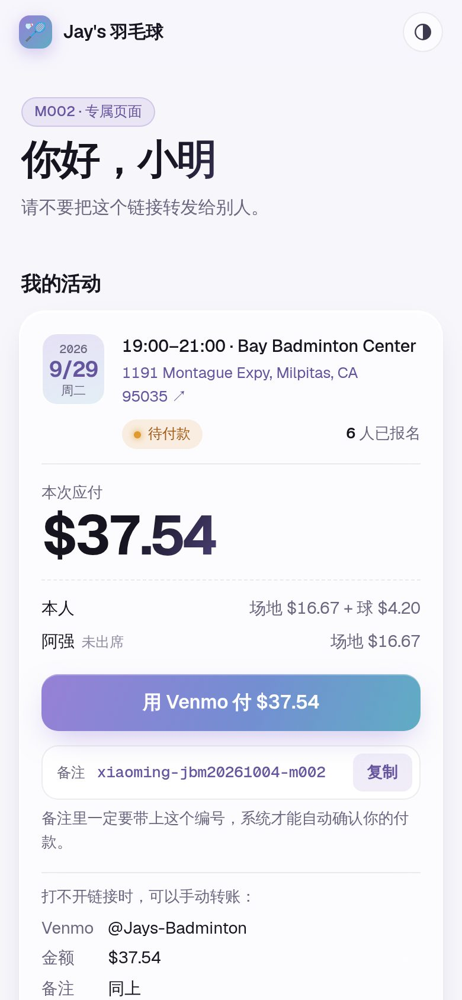
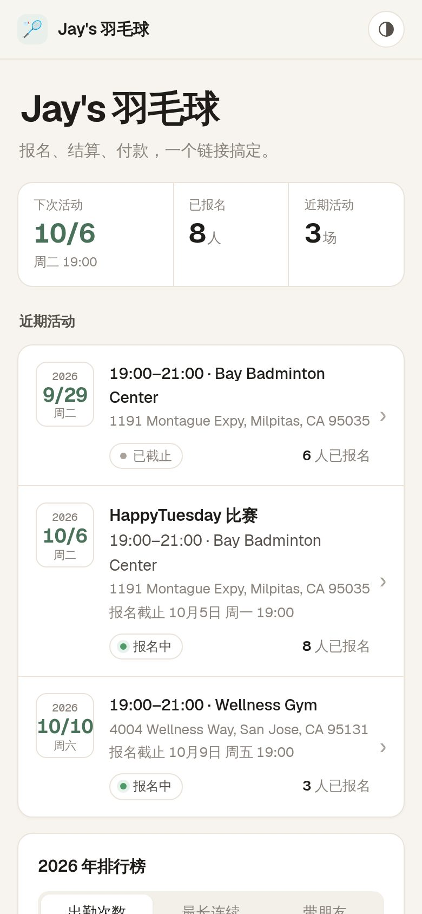
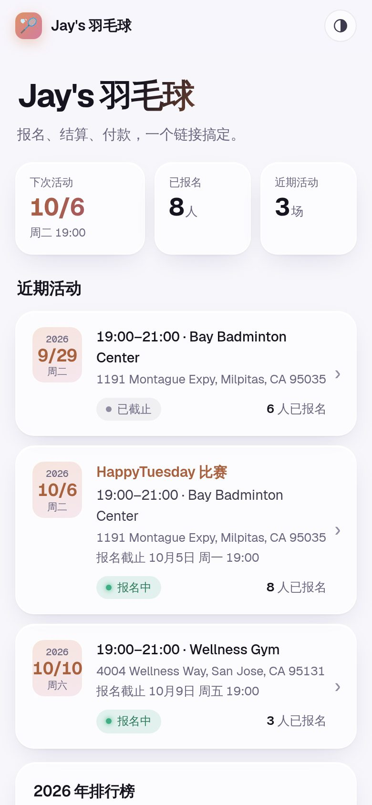

# Jay's Badminton

羽毛球群的报名与收费系统：成员通过专属链接报名，Owner 输入场地费和用球数后系统自动算出每人金额，成员点预填的 Venmo 链接付款，系统读取转发来的 Venmo 收款邮件自动标记已付，Owner 在管理页一眼看到钱是否收齐。

A sign-up and fee-collection site for a casual weekly badminton group (~50 members, 20–30 per session). Members sign up through a private link, the Owner enters court and shuttlecock costs, the system splits the bill, members pay through a pre-filled Venmo link, and forwarded Venmo receipt emails mark payments as paid automatically. Notifications go to the Owner on Telegram, ready to paste into WeChat.

- **Site**: https://jaysbadminton.llmat.dev
- **Stack**: Preact + Vite front end; Hono API on Cloudflare Workers with D1 (SQLite), Cron Triggers and Email Routing, all on the free tier; Telegram for notifications; optional daily Google Sheets mirror via Apps Script

## Screenshots

Phone-sized renders with demo data (names, venues and accounts are made up).

<table>
  <tr>
    <td align="center"><br><sub>公开首页：近期活动、排行榜（不显示名单和金额）</sub></td>
    <td align="center"><br><sub>成员专属页：账单明细、一键 Venmo 付款</sub></td>
    <td align="center"><br><sub>简约 · 深色</sub></td>
  </tr>
  <tr>
    <td align="center"><br><sub>管理页：活动列表</sub></td>
    <td align="center"><br><sub>到场标记与收款看板</sub></td>
    <td align="center"><br><sub>新建活动：最近的场馆、地址联想</sub></td>
  </tr>
  <tr>
    <td align="center"><br><sub>设置：默认外观、收款设置（加锁）、公共页面</sub></td>
    <td align="center"><br><sub>右上角 ◐：每个人自己选风格、强调色、浅色 / 深色</sub></td>
    <td align="center"><br><sub>极光风格 · 紫青</sub></td>
  </tr>
  <tr>
    <td align="center"><br><sub>极光 · 深色</sub></td>
    <td align="center"><br><sub>简约 · 森林绿</sub></td>
    <td align="center"><br><sub>极光 · 日落</sub></td>
  </tr>
</table>

## Features

- **报名**：成员用专属链接报名、带朋友；管理员可代加临时人员、立即截止、紧急修改时间地点
- **结算**：输入场地费、用球数和单价，按到场情况自动算出每人金额（含朋友份额）
- **收款**：预填 Venmo 链接；Gmail 转发的 Venmo 收款邮件经签名校验后自动对账，支持部分付款、多付退款、待确认关联
- **通知**：Telegram 截止前提醒、截止名单、结算提醒、每日账单提醒（可直接复制到微信）、收齐存档；Venmo 邮件异常和转发中断告警、每周健康简报
- **分享与日历**：微信分享卡片显示活动时间地点和人数；一键加入 iPhone / Google 日历；挥拍图标，可添加到手机主屏幕
- **统计与数据**：公开排行榜、个人统计、CSV 导出、每天同步到 Google 表格
- **管理**：成员审核 / 停用 / 恢复 / 删除，收款设置加锁，两种外观风格 × 4 个强调色（每人可自选、支持深色），管理员指南，Telegram 找回管理链接

## Docs

| Document | Language | What it covers |
| --- | --- | --- |
| [docs/requirements.zh.md](docs/requirements.zh.md) | 中文 | 需求文档：业务规则、页面、费用计算、对账、通知 |
| [docs/technical-design.md](docs/technical-design.md) | English | Architecture, data model, API, email ingestion, jobs, deployment, setup checklist |
| [docs/launch-checklist.md](docs/launch-checklist.md) | 中文 | 上线检查清单：交接、管理员首次设置、真实环境验证、日常维护 |

## Development

Google 登录支持成员自行注册、报名和查看账单，旧成员可绑定 Google 保留历史记录。配置 OAuth Client 和本地/正式回调地址请参见 [Google 登录配置](docs/google-login.zh.md)。没有配置 Google Client 时，原有成员链接仍可使用。

Requires Node.js 22.

```sh
npm install
npm run db:migrate:local   # create the local D1 database
printf 'TOKEN_KEY="dev"\nADMIN_PASSWORD="dev-password"\n' > .dev.vars
npm run dev                # build the front end and serve everything on http://localhost:8787
npm test                   # Vitest inside the Workers runtime, against a local D1
npm run typecheck
```

| Path | Contents |
| --- | --- |
| `src/worker/` | Cloudflare Worker: Hono API, cron and email handlers |
| `src/web/` | Preact front end (built by Vite into `dist/web`, served as static assets) |
| `migrations/` | D1 schema migrations |
| `test/` | Vitest tests |

## Deployment

Two sites, deployed by GitHub Actions (`.github/workflows/ci.yml`):

| | Address | Deployed when | Database |
| --- | --- | --- | --- |
| **Test site** | https://staging.jaysbadminton.llmat.dev (yellow 测试环境 banner, not indexed) | every merge to `main` | `jaysbadminton-staging` |
| **Production** | https://jaysbadminton.llmat.dev | a release tag `vYYYY.MM.DD` is pushed | `jaysbadminton` |

Every pull request, merge and tag runs typecheck, tests, build and the browser tests (`npm run test:e2e`, Playwright on a local Worker). A deploy finds or creates its D1 database, applies migrations, runs `wrangler deploy` (attaching the custom domain), syncs secrets, and smoke-tests the site from the outside (`scripts/smoke.mjs`). A production deploy also refuses a tag that is not on `main`, and first exports the production database as a workflow artifact (kept 90 days).

**Release**: try the change on the test site, then push a tag on `main` — e.g. `git tag v2026.10.05 && git push origin v2026.10.05` (a second release that day: `v2026.10.05.2`) — or GitHub → Releases → Draft a new release → new tag → Generate release notes → Publish.
**Roll back**: Actions → CI → Run workflow → *Use workflow from* the previous tag. Migrations only ever add, so older code runs on the newer database.
**Recommended rulesets**: `main` — require a pull request (and status check `check`); tags `v*` — only Repository admin may create, so only the Owner can release.

Repository secrets required:

| Secret | Where to get it |
| --- | --- |
| `CLOUDFLARE_ACCOUNT_ID` | Cloudflare dashboard → any domain's Overview page, right column |
| `CLOUDFLARE_API_TOKEN` | Cloudflare → My Profile → API Tokens → Create Token → "Edit Cloudflare Workers" template, add **Account · D1 · Edit**, limit to this account and the `llmat.dev` zone |
| `TELEGRAM_BOT_TOKEN` | Telegram → @BotFather → `/newbot`. Optional; notifications stay off without it. The Owner connects their own Telegram from the admin settings |
| `GOOGLE_MAPS_API_KEY` | Optional. Google Cloud → enable **Places API (New)** → API key restricted to that API. Makes address suggestions fast; without it the free (slower) Photon service is used. Usage stays inside Google's free monthly calls |
| `ADMIN_PASSWORD` | Your choice. Initial admin password, and the recovery path: change it and redeploy to reset a forgotten password |
| `TELEGRAM_BOT_TOKEN_STAGING` | A second bot from @BotFather for the test site (a bot has one webhook, so the sites cannot share one). Optional |
| `ADMIN_PASSWORD_STAGING` | Admin password for the test site (first-time setup at `staging…/admin`, and its recovery path); falls back to `ADMIN_PASSWORD` when not set |

CI also generates each site's `TOKEN_KEY` Worker secret on its first deploy and never replaces it.

### First-time setup and recovery

- Open `/admin`, enter `ADMIN_PASSWORD`, and save the admin link and your own member link it shows. The admin page then needs both the link and the password (remembered for 30 days per device).
- **Forgot the password**: change the `ADMIN_PASSWORD` secret, then Actions → CI → Run workflow on the **latest release tag** (production) or on `main` (test site).
- **Lost the admin link**: Actions → CI → Run workflow on the latest release tag with `reset_admin_link` ticked, then open `/admin` again.
- **Hand over to a new Owner / start fresh**: admin page → 设置 → 清空所有数据 (phrase + password). Everything except the admin password is deleted; the new Owner then runs first-time setup at `/admin` with that password and changes it. D1 Time Travel can restore the previous 7 days if needed, and every release keeps a database export.
