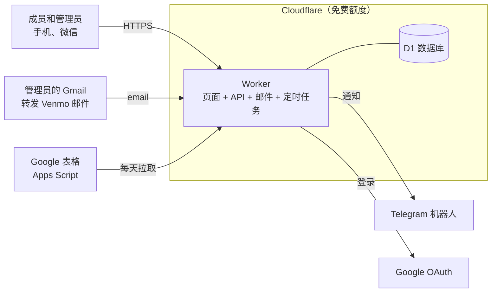

# Jay's 羽毛球 · Jay's Badminton

一个羽毛球群的报名和收费网站。成员在手机上报名、带朋友、看名单；活动结束后管理员填上场地费和用球数，系统自动算出每人该付多少，成员点一下就能用 Venmo 付款，Venmo 的收款邮件转发进来以后会自动对账、自动标记已付。管理员不用再在微信群里接龙、对着计算器分账、翻 Venmo 记录核对谁付了没有。

A sign-up and fee-collection site for a weekly badminton group (about 50 members, 20–30 per session), built on Cloudflare's free tier.

- **正式网站**：https://jaysbadminton.llmat.dev
- **测试网站**：https://staging.jaysbadminton.llmat.dev（顶部有黄色「测试环境」横幅，数据和正式网站分开）

<table>
  <tr>
    <td align="center"><br><sub>公开首页：近期活动和排行榜，不显示名单和金额</sub></td>
    <td align="center"><br><sub>成员页面：账单明细，一键 Venmo 付款</sub></td>
    <td align="center"><br><sub>管理页：到场标记和收款看板</sub></td>
  </tr>
  <tr>
    <td align="center"><br><sub>新建活动：常用场馆、地址联想</sub></td>
    <td align="center"><br><sub>每个人自己选外观</sub></td>
    <td align="center"><br><sub>极光风格 · 深色</sub></td>
  </tr>
</table>

截图用的是演示数据，人名、场馆和账号都是虚构的。

---

## 一、项目特色

**报名不用接龙**
- 成员用 Google 账号登录（或管理员私发的专属链接），点「报名」，可以带朋友并写上朋友的名字。
- 报了名的人能看到完整名单（包括谁带了谁）；公开页面和微信分享卡片只显示人数，从不显示名字。
- 一键加入 iPhone / Outlook / Google 日历，提前 2 小时提醒。

**算账不用计算器**
- 管理员勾选谁到了场，输入场地总费用、用球个数和单价，系统按规则算出每个人的金额：场地费所有报名的人平摊，球费到场的人平摊，带的朋友算在带他的人账上。
- 金额全部用整数「分」计算并向上取整，不会因为小数误差少收钱；可以先预览再确认。

**收款不用对账**
- 每个人的付款页面有一个预填好收款人、金额和备注编号的 Venmo 按钮。
- 管理员的 Gmail 把 Venmo 的收款邮件转发给网站，网站校验 Venmo 的数字签名后按备注编号自动标记已付；部分付款、多付要退款、编号写错的都会单独列出来让管理员确认。
- 所有人付清后自动归档，并给管理员发一条带明细的收齐消息。

**通知到 Telegram**
- 截止前提醒、报名截止那一刻的名单、活动结束后提醒结算、每天的催款提醒、收齐存档、每周健康简报。
- 每条通知里都附好了可以直接复制到微信群的文字。

**每个人自己的页面**
- 「我的活动」：自己报名的活动从新到旧排列，已经结束并付清的折叠进「历史活动」。
- 「个人信息」：花费图表（可选 7 天到全部的时间范围）、GitHub 式的参加热力图、入群时间和联系邮箱。
- 两种外观风格 × 4 种强调色，支持深色模式，每个人自己选。

**零成本、好维护**
- 全部运行在 Cloudflare 免费额度内（Workers + D1 数据库 + 定时任务 + 邮件路由），唯一的花费是域名。
- 改动先自动部署到测试网站，确认没问题再打版本标签发布到正式网站；发布前自动备份数据库，出问题可以一键回滚。
- 每天自动把数据同步一份到管理员自己的 Google 表格。

---

## 二、用户指南

### 成员

1. **加入**：打开网站首页，点「登录 / 我的活动」用 Google 账号申请，填用户名和微信昵称。也可以点「申请加入」不用 Google。管理员审核通过后就能报名。
2. **报名**：在首页点一个活动，或在「我的活动」的「可以报名」里点「报名」。可以带朋友（有上限），截止前随时修改或取消。
3. **看名单**：报名以后，活动卡片上能看到所有报名的人。
4. **付款**：活动结算后，「我的活动」里会出现本次应付金额。点「用 Venmo 付」，**备注里的编号不要删**，系统靠它自动对账。在微信里打不开 Venmo 时，按提示「在浏览器中打开」。
5. **我的活动和个人信息**：点右上角头像，可以进入「我的活动」「个人信息」，或者退出登录。用专属链接的成员，在「我的活动」页点「个人信息 ›」，也可以在那里绑定 Google 账号，以后直接用 Google 登录。

### 管理员

| 要做的事 | 在哪里 |
| --- | --- |
| 第一次设置 | 打开 `/admin`，输入管理密码，收藏生成的管理链接。然后在「设置 → 用 Google 登录管理页」绑定自己的 Google 账号，以后用 Google 登录就能直接进管理页 |
| 审核新成员 | 「待审核」→ 通过 / 拒绝。用 Google 申请的人通过后自己登录即可；用「申请加入」的人，把专属链接或二维码私发给对方 |
| 管理成员 | 「成员」：点名字看个人信息、加只有自己能看到的备注名；停用、恢复、删除（删除后名字可以给新人用，旧记录显示为「名字（编号）」） |
| 建活动、自己报名 | 「活动 → 新建活动」。自己打球在活动详情的「我的报名」里报名，不受带朋友上限限制 |
| 改名单 | 活动详情：代加临时人员、替换、删除；立即截止、重新开放、修改时间地点 |
| 结算 | 活动结束后：标记谁没到场 → 输入场地费、用球数和单价 → 预览每人金额 → Finalize |
| 收款 | 「收款」看板自动更新；「待确认」里处理对不上的付款；也可以手动标记已付、记录退款 |
| 通知 | 「设置 → 连接 Telegram」。给机器人发「管理页面」可以找回管理链接 |
| 其他设置 | 收款账号（加锁）、带朋友上限、提醒时间、默认外观、网站标题、排行榜开关、导出 CSV、Google 表格同步 |

管理页里的「管理员指南」有逐项打勾的上线清单，第一次设置时照着走一遍即可。

### 网站维护者

- **发布**：改动合并到 `main` 后自动部署到测试网站；测试没问题后，在 GitHub → Releases 新建一个 `vYYYY.MM.DD` 标签（同一天第二次加 `.2`），会先备份正式数据库再部署到正式网站。
- **回滚**：Actions → CI → Run workflow，「Use workflow from」选上一个版本标签。
- **忘记管理密码**：修改 GitHub secret `ADMIN_PASSWORD`（测试网站是 `ADMIN_PASSWORD_STAGING`），再按上面的方法重新部署一次。
- **丢了管理链接**：已绑定 Google 的话直接用 Google 登录；或者在 Telegram 给机器人发「管理页面」；或者运行一次部署并勾选 `reset_admin_link`（正式网站选最新版本标签，测试网站选 `main`），然后回到 `/admin` 重新设置。数据不受影响。
- 上线前要在真实手机和账号上确认的事项见 [docs/launch-checklist.md](docs/launch-checklist.md)。

---

## 三、技术架构



一个 Cloudflare Worker 同时提供网页、JSON API、接收转发的 Venmo 邮件，并每分钟运行一次定时任务，所有数据都在一个 D1（SQLite）数据库里。

| 部分 | 选择 |
| --- | --- |
| 前端 | Preact + Vite，中文界面，手机优先，没有 CSS 框架（照顾微信内置浏览器） |
| 后端 | Hono，运行在 Cloudflare Workers 上 |
| 数据库 | Cloudflare D1，`migrations/` 里按编号的 SQL 迁移 |
| 登录 | Google OAuth（Authorization Code + PKCE）；或每人一个随机令牌的专属链接；管理页是管理链接 + 密码，或管理员绑定的 Google 账号 |
| 邮件 | Cloudflare Email Routing → Worker，自己校验 Venmo 的 DKIM 签名，`postal-mime` 解析 |
| 通知 | Telegram Bot API |
| 测试 | Vitest（在 Workers 运行时里跑，连本地 D1）+ Playwright 浏览器测试 |
| 部署 | GitHub Actions：PR 跑检查；合并到 `main` 部署测试网站；`v*` 标签部署正式网站 |

### 一些设计要点

- **隐私**：公开页面只显示人数；令牌在数据库里只存哈希和加密后的密文；导出和表格同步从不包含令牌。一个 Google 账号只能对应一个人。
- **算钱**：结算是一个纯函数 `settle()`，预览和 Finalize 共用，全程整数「分」并向上取整，有单元测试覆盖需求文档里的例子。
- **付款编号**：形如 `xiaoming-jbm20261006-m007`，对账只认日期和成员编号部分，改名不影响。
- **自动对账**：只接受签名有效的 Venmo 邮件；金额对上就标记已付，部分付款和多付会通知管理员；伪造的邮件在签名校验这一步就被丢弃。
- **定时任务**：每分钟运行，截止时间都是整分钟，所以「报名截止」在截止那一刻发出；每条通知都记录在 `notification_log` 里，重试也不会重复发送。
- **归档**：所有人付清后活动变为「已收齐」，之后不能再修改；状态转换在每个接口里都会检查。

### 目录

| 路径 | 内容 |
| --- | --- |
| `src/worker/` | Worker：Hono API、Google 登录、定时任务、邮件处理、结算、Telegram |
| `src/web/` | Preact 前端（Vite 构建到 `dist/web`，作为静态资源提供） |
| `src/shared/` | 前后端共用：类型、结算、时间、外观、日历、花费统计 |
| `migrations/` | D1 数据库迁移 |
| `test/`、`e2e/` | 单元 / 集成测试，浏览器测试 |
| `scripts/` | CI 用的脚本：查找或创建 D1、同步 secrets、冒烟测试、本地测试服务器 |
| `docs/` | 需求文档、技术设计、Google 登录配置、上线检查清单 |

### 本地开发

需要 Node.js 22。

```sh
npm install
npm run db:migrate:local      # 建本地 D1 数据库
printf 'TOKEN_KEY="dev"\nADMIN_PASSWORD="dev-password"\n' > .dev.vars
npm run dev                   # 构建前端并在 http://localhost:8787 启动
npm test                      # 单元测试
npm run test:e2e              # 浏览器测试（在本地 Worker 上用全新的数据库）
npm run typecheck
```

### 部署配置

| | 地址 | 什么时候部署 | 数据库 |
| --- | --- | --- | --- |
| 测试网站 | https://staging.jaysbadminton.llmat.dev | 每次合并到 `main` | `jaysbadminton-staging` |
| 正式网站 | https://jaysbadminton.llmat.dev | 推送 `vYYYY.MM.DD` 标签 | `jaysbadminton` |

每次部署会找到或创建对应的 D1 数据库、执行迁移、`wrangler deploy`、同步 secrets，并从外部冒烟测试一遍。正式部署会拒绝不在 `main` 上的标签，并先把数据库导出为 Actions 的附件（保留 90 天）。迁移只会增加内容，所以回滚到旧版本也能在新数据库上运行。

GitHub 仓库需要的 secrets：

| Secret | 说明 |
| --- | --- |
| `CLOUDFLARE_ACCOUNT_ID`、`CLOUDFLARE_API_TOKEN` | Cloudflare 账号和 API 令牌（Workers 编辑 + D1 编辑权限） |
| `ADMIN_PASSWORD` | 正式网站的初始管理密码，也是忘记密码时的重置方法 |
| `ADMIN_PASSWORD_STAGING` | 测试网站的管理密码（不设置时沿用 `ADMIN_PASSWORD`） |
| `TELEGRAM_BOT_TOKEN`、`TELEGRAM_BOT_TOKEN_STAGING` | 两个 Telegram 机器人（一个机器人只能有一个 webhook），可选 |
| `GOOGLE_CLIENT_ID`、`GOOGLE_CLIENT_SECRET` | Google 登录，可选；配置方法见 [docs/google-login.zh.md](docs/google-login.zh.md) |
| `GOOGLE_MAPS_API_KEY` | 地址联想，可选；没有时使用免费的 Photon |

每个网站的 `TOKEN_KEY` 由 CI 在第一次部署时自动生成，之后不再更换。

### 文档

| 文档 | 内容 |
| --- | --- |
| [docs/requirements.zh.md](docs/requirements.zh.md) | 需求文档：业务规则、页面、费用计算、对账、通知 |
| [docs/technical-design.md](docs/technical-design.md) | 技术设计（英文）：架构、数据表、API、邮件处理、定时任务、部署 |
| [docs/google-login.zh.md](docs/google-login.zh.md) | Google 登录：OAuth 配置、成员和管理员的使用方式 |
| [docs/launch-checklist.md](docs/launch-checklist.md) | 上线检查清单：交接、首次设置、真实环境验证、日常维护 |
