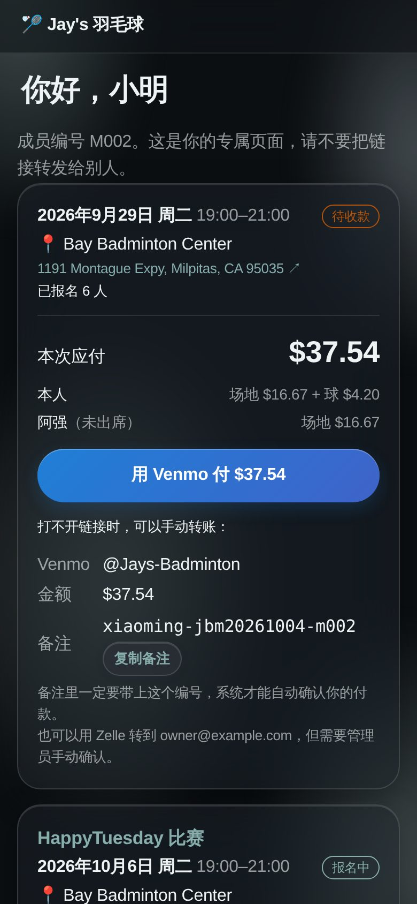
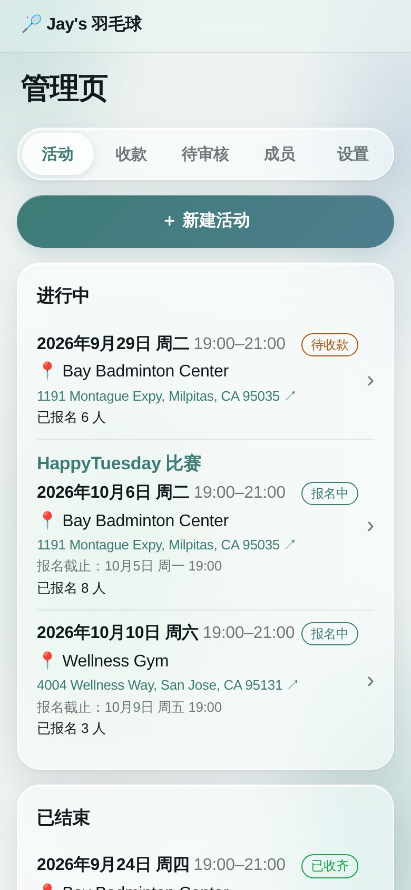
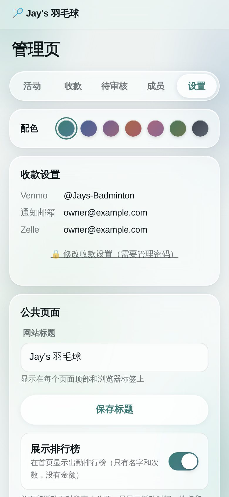
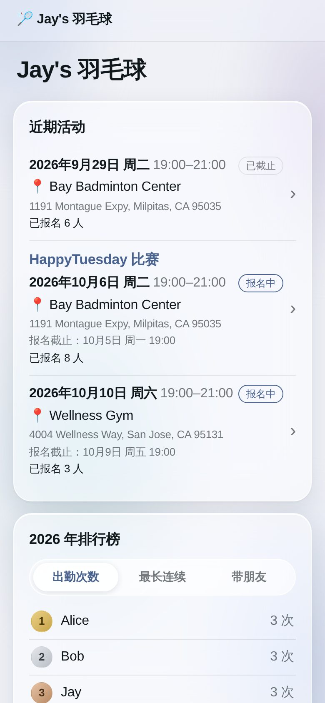
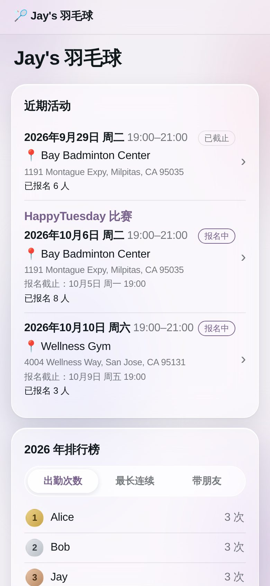
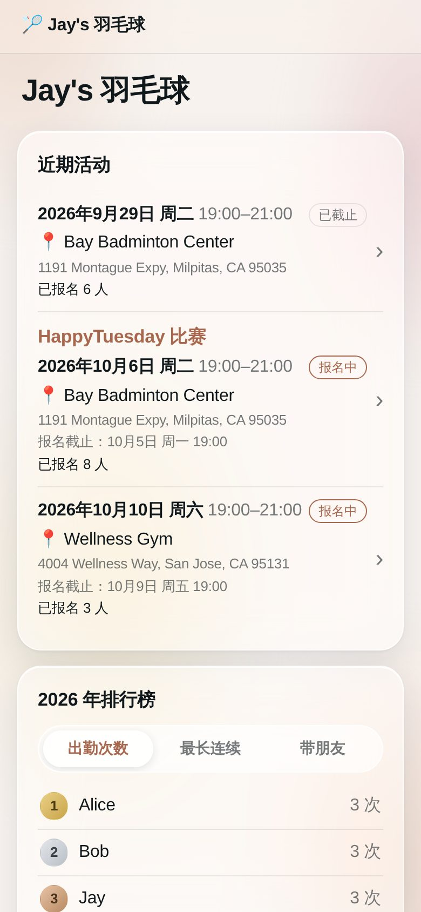
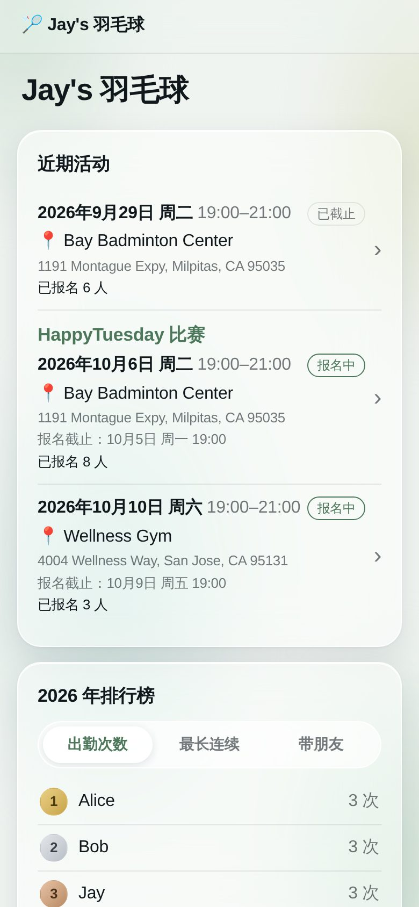

# Jay's Badminton

羽毛球群的报名与收费系统：成员通过专属链接报名，Owner 输入场地费和用球数后系统自动算出每人金额，成员点预填的 Venmo 链接付款，系统读取转发来的 Venmo 收款邮件自动标记已付，Owner 在管理页一眼看到钱是否收齐。

A sign-up and fee-collection site for a casual weekly badminton group (~50 members, 20–30 per session). Members sign up through a private link, the Owner enters court and shuttlecock costs, the system splits the bill, members pay through a pre-filled Venmo link, and forwarded Venmo receipt emails mark payments as paid automatically. Notifications go to the Owner on Telegram, ready to paste into WeChat.

- **Site**: https://jaysbadminton.llmat.dev
- **Stack**: Preact + Vite front end; Hono API on Cloudflare Workers with D1 (SQLite), Cron Triggers and Email Routing, all on the free tier; Telegram for notifications; optional daily Google Sheets mirror via Apps Script

## Screenshots

Phone-sized renders with demo data (names, venues and accounts are made up).

<table>
  <tr>
    <td align="center"><br><sub>公开首页：近期活动、排行榜（不显示名单和金额）</sub></td>
    <td align="center"><br><sub>成员专属页：账单明细、一键 Venmo 付款</sub></td>
    <td align="center"><br><sub>深色模式</sub></td>
  </tr>
  <tr>
    <td align="center"><br><sub>管理页：活动列表</sub></td>
    <td align="center"><br><sub>到场标记与收款看板</sub></td>
    <td align="center"><br><sub>新建活动：最近的场馆、地址联想</sub></td>
  </tr>
  <tr>
    <td align="center"><br><sub>设置：配色、收款设置（加锁）、公共页面</sub></td>
    <td align="center" colspan="2">
      
      
      
      
      <br><sub>7 种低饱和度配色，管理员一键切换</sub>
    </td>
  </tr>
</table>

## Features

- **报名**：成员用专属链接报名、带朋友；管理员可代加临时人员、立即截止、紧急修改时间地点
- **结算**：输入场地费、用球数和单价，按到场情况自动算出每人金额（含朋友份额）
- **收款**：预填 Venmo 链接；Gmail 转发的 Venmo 收款邮件经签名校验后自动对账，支持部分付款、多付退款、待确认关联
- **通知**：Telegram 截止前提醒、截止名单、结算提醒、每日账单提醒（可直接复制到微信）、收齐存档
- **统计与数据**：公开排行榜、个人统计、CSV 导出、每天同步到 Google 表格
- **管理**：成员审核 / 停用 / 恢复 / 删除，收款设置加锁，配色模板，管理员指南，Telegram 找回管理链接

## Docs

| Document | Language | What it covers |
| --- | --- | --- |
| [docs/requirements.zh.md](docs/requirements.zh.md) | 中文 | 需求文档：业务规则、页面、费用计算、对账、通知 |
| [docs/technical-design.md](docs/technical-design.md) | English | Architecture, data model, API, email ingestion, jobs, deployment, setup checklist |
| [docs/launch-checklist.md](docs/launch-checklist.md) | 中文 | 上线检查清单：交接、管理员首次设置、真实环境验证、日常维护 |

## Development

Requires Node.js 22.

```sh
npm install
npm run db:migrate:local   # create the local D1 database
printf 'TOKEN_KEY="dev"\nADMIN_PASSWORD="dev-password"\n' > .dev.vars
npm run dev                # build the front end and serve everything on http://localhost:8787
npm test                   # Vitest inside the Workers runtime, against a local D1
npm run typecheck
```

| Path | Contents |
| --- | --- |
| `src/worker/` | Cloudflare Worker: Hono API, cron and email handlers |
| `src/web/` | Preact front end (built by Vite into `dist/web`, served as static assets) |
| `migrations/` | D1 schema migrations |
| `test/` | Vitest tests |

## Deployment

Every push to `main` runs typecheck, tests and build, then deploys with GitHub Actions (`.github/workflows/ci.yml`): it finds or creates the `jaysbadminton` D1 database, applies migrations, runs `wrangler deploy` (which also attaches the `jaysbadminton.llmat.dev` custom domain), and finally smoke-tests the live site from the outside (`scripts/smoke.mjs`).

Repository secrets required:

| Secret | Where to get it |
| --- | --- |
| `CLOUDFLARE_ACCOUNT_ID` | Cloudflare dashboard → any domain's Overview page, right column |
| `CLOUDFLARE_API_TOKEN` | Cloudflare → My Profile → API Tokens → Create Token → "Edit Cloudflare Workers" template, add **Account · D1 · Edit**, limit to this account and the `llmat.dev` zone |
| `TELEGRAM_BOT_TOKEN` | Telegram → @BotFather → `/newbot`. Optional; notifications stay off without it. The Owner connects their own Telegram from the admin settings |
| `GOOGLE_MAPS_API_KEY` | Optional. Google Cloud → enable **Places API (New)** → API key restricted to that API. Makes address suggestions fast; without it the free (slower) Photon service is used. Usage stays inside Google's free monthly calls |
| `ADMIN_PASSWORD` | Your choice. Initial admin password, and the recovery path: change it and redeploy to reset a forgotten password |

CI also generates the `TOKEN_KEY` Worker secret on the first deploy and never replaces it.

### First-time setup and recovery

- Open `/admin`, enter `ADMIN_PASSWORD`, and save the admin link and your own member link it shows. The admin page then needs both the link and the password (remembered for 30 days per device).
- **Forgot the password**: change the `ADMIN_PASSWORD` secret, then Actions → CI → Run workflow on `main`.
- **Lost the admin link**: Actions → CI → Run workflow on `main` with `reset_admin_link` ticked, then open `/admin` again.
- **Hand over to a new Owner / start fresh**: admin page → 设置 → 清空所有数据 (phrase + password). Everything except the admin password is deleted; the new Owner then runs first-time setup at `/admin` with that password and changes it. D1 Time Travel can restore the previous 7 days if needed.
