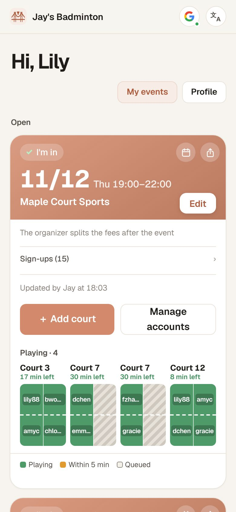
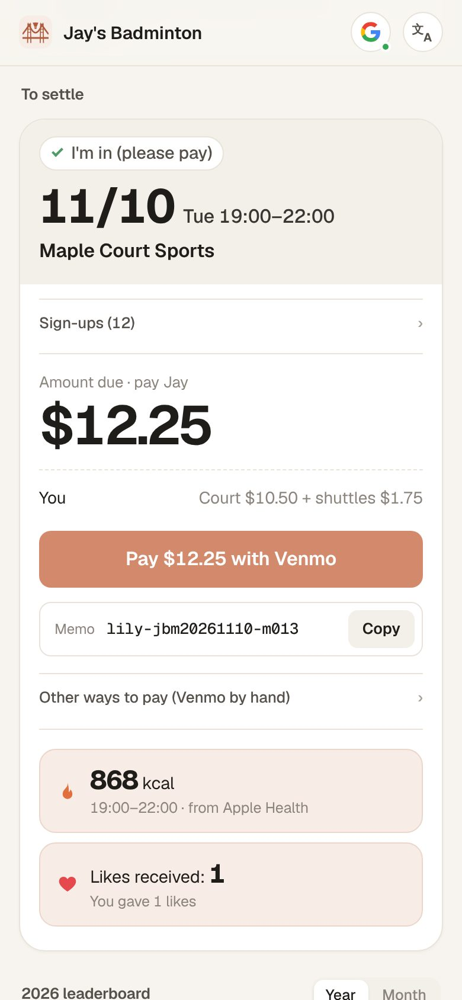
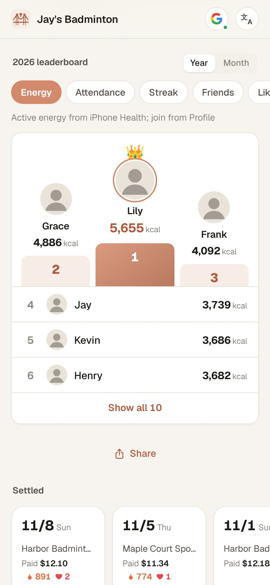
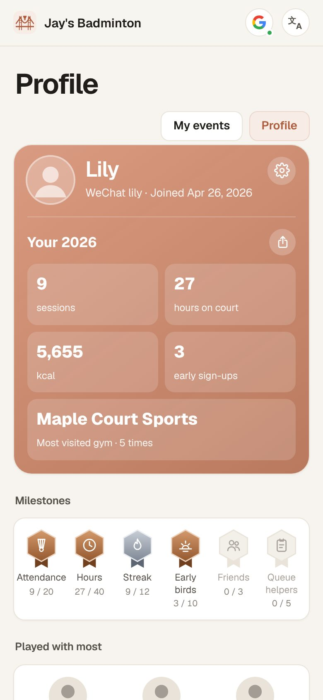
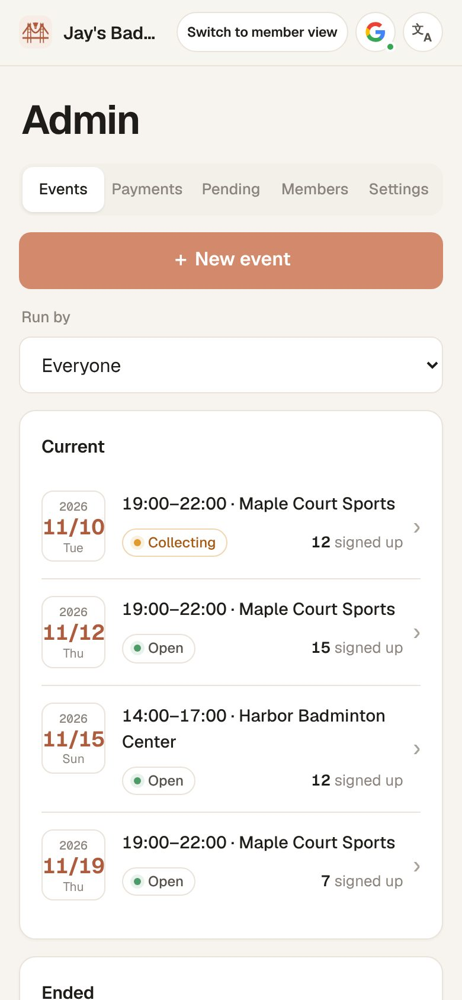
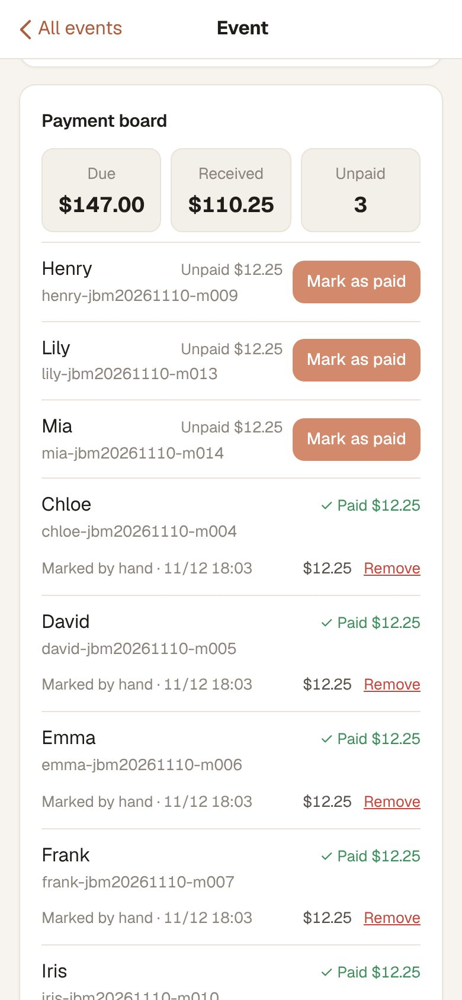
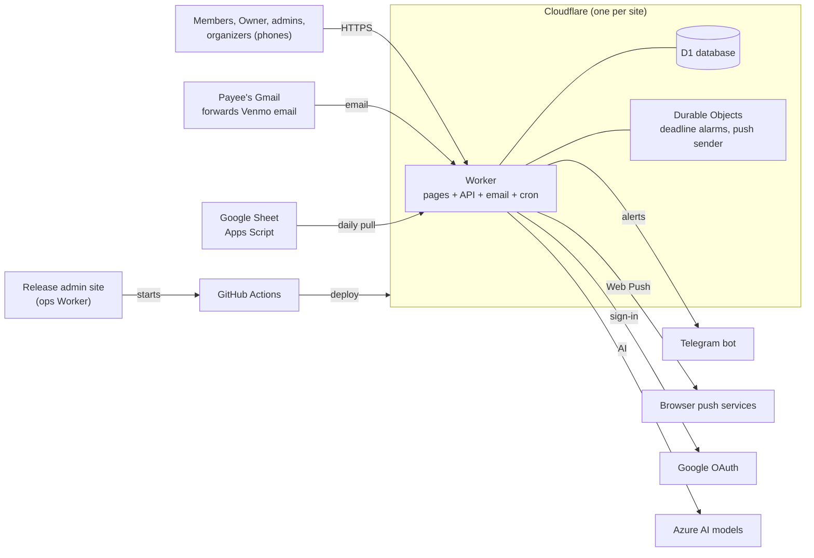

# Jay's Badminton

Sign-ups, rosters, fees and payments for badminton groups, in one mobile-first website.

- **Production**: https://jaysbadminton.llmat.dev
- **Test site (staging)**: https://staging.jaysbadminton.llmat.dev (purple logo, separate data)
- **Other groups' sites**: https://sbbc.llmat.dev, https://bewithyou.llmat.dev, https://coco.llmat.dev
- **Release admin site**: https://badminton.llmat.dev (maintainer only)

<table>
  <tr>
    <td align="center"><br><sub>My events: sign-up status and the live court queue</sub></td>
    <td align="center"><br><sub>The bill: one tap to pay with Venmo</sub></td>
    <td align="center"><br><sub>Leaderboards and past events</sub></td>
  </tr>
  <tr>
    <td align="center"><br><sub>Profile: yearly review and milestones</sub></td>
    <td align="center"><br><sub>Admin view: all events</sub></td>
    <td align="center"><br><sub>Admin view: payment board of one event</sub></td>
  </tr>
</table>

Screenshots use demo data; the names, venues and accounts are made up.

---

## 1. Introduction

A badminton group plays a few times a week at one or more gyms. Without a tool, someone collects names in a WeChat chain, works out everyone's share with a calculator, and checks Venmo history to see who has paid. This site replaces all of that:

- Members sign in with Google, sign up for an event (with friends if they like) and see who else is coming.
- After the event the organizer enters the court cost and shuttles used; the site splits the bill to the cent.
- Each member taps one button to pay with Venmo. The Venmo receipt email is forwarded to the site, which verifies it and marks the payment as paid by itself.
- On the day, players can share gym accounts, track the court queue and see who is there when.
- Afterwards there are calories, likes, leaderboards and a yearly review to keep things fun.

The same code runs one isolated site per group: each has its own Cloudflare Worker, D1 database, domain, Owner and Telegram bot, and the groups never see each other's data.

The UI is available in Simplified Chinese, Traditional Chinese and English (each person picks), with light and dark modes and several looks.

## 2. Features

### Sign-up and events
- **Google-only sign-in.** Newcomers apply with Google; the Owner or an admin approves them (or turns on "no approval needed" with a daily cap). One Google account belongs to one member.
- **Events** have a time, a venue (with address suggestions and remembered recent venues), an optional sign-up deadline and a cap on friends per member.
- **Bring friends**, either by name or by picking a registered member; their share goes on the bringer's bill.
- **Arrive / leave times**: each player can say when they come and go, and the event shows a 15-minute headcount chart.
- **Roster** visible to signed-up members only; public pages, share cards and link previews show the headcount, never names.
- **Calendar**: add to Apple Calendar, Outlook or Google Calendar.
- **Share card**: an image with date, time, venue and a QR code for open events, ready to post in a group chat.
- **Event links** like `/e/26-1105` are fixed when the event is created and never reused.

### Fees and payments
- **Exact split**: court cost is shared by everyone who signed up, shuttles by those who showed up; all amounts are whole cents and always add up to the total. Preview before you finalize.
- **One-tap Venmo** with payee, amount and a payment code pre-filled. Zelle details can be shown too (matched by hand).
- **Automatic matching**: forwarded Venmo emails are checked against Venmo's DKIM signature and matched by the payment code. Partial payments, overpayments and unclear ones go to a review list.
- **Refunds and corrections** are recorded one by one; if fees change after finalizing, each person sees what they still owe or will get back.
- **No-fee events** skip billing entirely.
- **Settle deadline**: unsettled events are reminded and, past the deadline, archived automatically. Events archive themselves once everyone has paid.
- **Each event's money goes to whoever created it** (their own Venmo and email forwarding).

### On the day
- **Court queue**: players add their gym accounts, record which court each group is on, the queue position and minutes left, and see an estimated wait. Idle accounts get a warning banner. **Court map**: the Owner, an admin or an organizer photographs the court map posted at a venue once; the AI model draws it, they fix numbers and positions (courts stay aligned in rows and columns) and save it for that venue's address. Players then see our courts coloured on the venue's floor plan, turned sideways on an upright phone.
- **Photo check-in**: take a photo of the gym's queue screen and an AI model reads our courts (needs the AI key).
- **Booked courts**: the organizer enters the booked court numbers; members get a push 10 minutes before start.

### After the event
- **Calories** from iPhone Health via an iOS Shortcut (opt-in).
- **Likes**: players can anonymously like others who played, within a time window and a cap.
- **Leaderboards**: energy (calories), attendance, hours, progress, streak, bringing friends, queue helpers, early birds and likes. The Owner chooses which boards are public.
- **Profile**: avatar (Google picture or your own photo), spending chart, attendance heatmap, badges and a yearly review.

### Roles
- **Owner** (群主): the top authority of a site; sets up the site, appoints and removes admins and organizers.
- **Admin** (管理员): runs the group like the Owner, minus the Owner-only powers. Every admin change is logged.
- **Organizer** (组织者): creates and runs their own events and collects their own money; sees the member list read-only.
- Owner, admins and organizers can switch between the admin view and the member view with the same account.

### Notifications
- **Web push** for members (new events, bills, changes someone else made to your sign-up, booked courts). On iPhone, add the site to the home screen first.
- **Telegram bot** for the Owner, each admin and each organizer: deadline reminders, the roster at the deadline, settle reminders, payment alerts, "all paid", weekly health digest, and a plain-language "new version released" note. Each chat picks its own language. Messages include text ready to paste into WeChat.

### For the site
- Installable as a home-screen app with pull-to-refresh; two-column layout on wide screens and foldables.
- Daily mirror of the data into the Owner's Google Sheet, plus CSV export.
- Privacy policy and terms pages; a sponsor line in the footer.

## 3. User guide

### Members
1. **Join**: open the site, tap **Log in / Sign up** at the top right and continue with Google. Fill in your name and WeChat name and wait for approval (or get in directly if the group needs no approval).
2. **Sign up**: on the home page, tap **Sign up** on an event card. Add friends if you bring any, and set your arrive/leave times if you don't stay the whole time. Tap **Change** on the card to edit or cancel before the deadline.
3. **On the day**: if the event uses the court queue, open **Courts** on the card to add your gym account and update the court status.
4. **Pay**: when the bill is out you get a push and the card turns to "please pay". Tap **Pay with Venmo** and **do not delete the code in the note**, it is how the payment is matched.
5. **Your page**: tap your avatar at the top right for your profile, avatar, language, appearance and push notifications.

Tip: in the WeChat built-in browser some things (Google sign-in, Venmo) don't work; open the page in Safari or Chrome.

### Owner, admins and organizers
Sign in with Google and open the admin view from the avatar menu (the Owner's first-time setup is at `/admin` with the setup password).

| Task | Where |
| --- | --- |
| Approve new members | **Pending** → approve / reject |
| Manage members | **Members**: profile, private note name, suspend, restore, delete |
| Create an event | **Events → New event**: time, venue, and switches for *collect money + auto matching*, *court queue* and *sign-up deadline* |
| Change the roster | Event page: add or remove people, close or reopen sign-up, edit time and place, book courts |
| Settle | After the event: mark no-shows → enter court cost and shuttles → preview → **Finalize** |
| Collect | **Payments** updates by itself; handle the review list, mark paid by hand, record refunds |
| Telegram | **Settings → Telegram**: connect your own chat; send 「语言」 to the bot to change its language |
| Settings (Owner/admins) | Payment accounts, joining rules, friend cap, reminders, settle deadline, likes, leaderboards, default look, site and app name, AI models, Google Sheet sync, export, key backup |
| Roles (Owner only) | **Settings**: appoint or remove admins and organizers |

The in-app **Guide** (for the Owner) and **Notes for admins and organizers** walk through the rest.

### Maintainer
- **Release**: merging to `main` deploys the test site. To release production, open https://badminton.llmat.dev, tick the sites and press **Release**, or run GitHub → Actions → **Release** (input *sites*: `all` or e.g. `jays, sbbc`; *version*: empty for a new `vYYYY.MM.DD` tag from `main`, or an existing tag to deploy it to the chosen sites). Each chosen site's database is backed up (encrypted) first, then migrated, deployed and smoke-tested, and its Owner and admins get a Telegram note. Details in [docs/release-site.zh.md](docs/release-site.zh.md).
- **Rollback**: same as release, with an older version. A version is locked when the site's database already ran a migration that the version doesn't know (see [Rollback limits](#rollback-limits)); the release admin site can restore a backup and switch in one step.
- **Add a group's site**: one line in `sites.json`, merge, release; then follow [docs/sites.zh.md](docs/sites.zh.md).
- **Lost Owner password** (Jay's sites): change the `ADMIN_PASSWORD` (or `ADMIN_PASSWORD_STAGING`) secret and deploy again. Before going live on real phones, see [docs/launch-checklist.md](docs/launch-checklist.md).

## 4. Developer guide

You need Node.js 22.

```sh
npm install
npm run db:migrate:local      # create the local D1 database
printf 'TOKEN_KEY="dev"\nADMIN_PASSWORD="dev-password"\nORGANIZERS="1"\n' > .dev.vars
npm run dev                   # build the web app and serve http://localhost:8787
npm test                      # unit and integration tests (Vitest in the Workers runtime)
npm run test:e2e              # browser tests (Playwright, on a fresh local database)
npm run typecheck
npm run lint                  # Biome; `npm run format` fixes what it can
```

### Repository layout

| Path | Contents |
| --- | --- |
| `src/worker/` | The Worker: Hono routes (`routes/`), Google sign-in, events, billing, Venmo email (`email/`), cron, Telegram, push, court queue, likes, avatars |
| `src/web/` | Preact single-page app (built by Vite into `dist/web`), pages in `pages/`, translations in `i18n.ts`, `messages.ts`, `adminMessages.ts` |
| `src/shared/` | Code used by both sides: types, settlement, time, rules, themes, calendar |
| `migrations/` | Numbered D1 SQL migrations |
| `ops/` | The release admin site (its own Worker) |
| `test/`, `e2e/` | Vitest tests, Playwright tests |
| `scripts/` | CI helpers: D1 lookup, secrets sync, backups, release plan and notes, migration checks, smoke test, local test server |
| `docs/` | Requirements, technical design, Google login, sites, release site, launch checklist, design notes |
| `sites.json` | The list of extra group sites |

### Working rules
- Every PR runs lint, typecheck, unit tests (two shards) and browser tests (two jobs). Merging to `main` deploys the test site and the release admin site.
- Update a PR branch by rebasing onto `main`, not by merging.
- Only add migrations, never edit old ones. A migration that only adds tables or settings old code ignores, and can safely run twice, may be listed in `scripts/rollback-safe-migrations.json`; one that adds columns cannot.
- Money is always in integer cents; `settle()` in `src/shared/settle.ts` is the one place that splits it, for preview and Finalize alike.
- New user-facing text needs all three languages. In English, call the place a *venue* or *gym* and a single playing area a *court*.
- The test site has a **developer login** on `/login` (password = the test site's Owner password) to try the admin and member views; production refuses it.
- The 组织者 (organizer/admin) features are behind the `ORGANIZERS` variable, which is on everywhere today.

### Configuration

GitHub Actions secrets (none are needed for local development):

| Secret | Purpose |
| --- | --- |
| `CLOUDFLARE_ACCOUNT_ID`, `CLOUDFLARE_API_TOKEN` | Deploys (Workers + D1 edit) |
| `ADMIN_PASSWORD`, `ADMIN_PASSWORD_STAGING` | First-time / recovery Owner password for Jay's production and test site |
| `LINK_ENCRYPTION_KEY`, `LINK_ENCRYPTION_KEY_STAGING` | Backups of each Jay's site's `TOKEN_KEY` (same value as the Worker secret); checked on every deploy |
| `SITES_KEY`, `SITES_ADMIN_PASSWORD` | Shared by all sites in `sites.json`: each site's `TOKEN_KEY` is derived from `SITES_KEY` and its id; the password is for first-time setup |
| `BACKUP_KEY` | Encrypts the database backups taken before each release |
| `GOOGLE_CLIENT_ID`, `GOOGLE_CLIENT_SECRET` | Google sign-in ([docs/google-login.zh.md](docs/google-login.zh.md)) |
| `TELEGRAM_BOT_TOKEN`, `TELEGRAM_BOT_TOKEN_STAGING` | Telegram bots for Jay's sites (other sites' Owners enter theirs in Settings) |
| `TELEGRAM_DEV_BOT_TOKEN`, `TELEGRAM_DEV_CHAT_ID` | Optional developer group: merges, releases, release admin sign-ins |
| `AZURE_FOUNDRY_API_KEY` | Optional AI models (photo check-in, plain-language release notes) |
| `GOOGLE_MAPS_API_KEY` | Optional address suggestions (Photon is used without it) |
| `RESEND_API_KEY`, `EMAIL_FROM` | Optional outgoing email |
| `OPS_EMAIL`, `OPS_GITHUB_TOKEN` | Release admin site: the owner who approves others (viewers, release engineers), and the token that starts workflows |

CI creates each site's `TOKEN_KEY` on first deploy and never changes it. It encrypts stored links and keys and peppers the Owner password hash, and Cloudflare never shows it again, so keep the backups above.

## 5. Technical architecture



One Cloudflare Worker per site serves the single-page app and the JSON API, receives forwarded Venmo email and runs a cron every 15 minutes. Each event has a Durable Object alarm that closes sign-up exactly at the deadline, and another Durable Object sends push backlogs. All data lives in that site's D1 (SQLite) database.

| Part | Choice |
| --- | --- |
| Frontend | Preact + preact-iso, Vite, plain CSS, mobile first, three languages |
| Backend | Hono on Cloudflare Workers (Workers Paid plan), placed near the database |
| Database | Cloudflare D1, numbered SQL migrations |
| Sign-in | Google OAuth (Authorization Code + PKCE), HttpOnly session cookie; Owner's first-time setup with an admin link + password |
| Email | Cloudflare Email Routing → Worker; own DKIM check, parsed with `postal-mime` |
| Notifications | Telegram Bot API; Web Push (VAPID, encrypted with WebCrypto) |
| AI | Models chosen in Settings, through Azure AI Foundry |
| Tests | Vitest in the Workers runtime with a local D1; Playwright |
| CI/CD | GitHub Actions: checks on PRs; `main` → test site + release admin site; Release workflow → chosen production sites |

### Design notes
- **Privacy**: public pages show headcounts only. Tokens are stored as hashes plus encrypted copies, never exported. Anonymous visitors don't see avatars. Content Security Policy is enforced.
- **Payment codes** look like `name-jbm20261105-m007`: the event number is fixed at creation and the member number never changes, so renames and date edits don't break matching.
- **Venmo matching** only trusts emails with a valid Venmo DKIM signature; raw emails are not stored. An optional, Owner-only diagnostics log keeps per-email steps for 14 days.
- **Cron** (every 15 minutes): settle reminders, daily payment reminders, settle-deadline archiving, Gmail forwarding checks, weekly digest, push backlog, and a backstop for any missed deadline alarm. Every notification is logged so a retry never sends twice.
- **Multi-site**: `sites.json` lists the extra sites; each gets Worker `jaysbadminton-<id>`, a database of the same name, its own icon colour and name. `/api/health` reports the version each site runs.

### Releases and backups
- A release tags `main` with the Pacific date (`vYYYY.MM.DD`, `.2`/`.3` for the same day), writes release notes from the merged PRs, then for each chosen site: encrypted D1 backup (kept 90 days in the private R2 bucket `jaysbadminton-backups`, never on GitHub), migration, deploy, smoke test, Telegram notice.
- `scripts/check-migrations.mjs` refuses to deploy a version older than the site's database.
- Download and decrypt a backup on your own computer:
  `npx wrangler r2 object get jaysbadminton-backups/FILE.sql.gz.enc --remote --file FILE.sql.gz.enc`
  `BACKUP_KEY='…' openssl enc -d -aes-256-cbc -pbkdf2 -iter 600000 -pass env:BACKUP_KEY -in FILE.sql.gz.enc | gunzip > FILE.sql`
- Load a decrypted backup into a new, empty D1 database (photos make some rows longer than D1's 100 KB limit per statement; `split-sql.mjs` rewrites those rows in pieces and checks the result holds the same data):
  `node scripts/split-sql.mjs FILE.sql FILE.import.sql && npx wrangler d1 execute NEW_DATABASE --remote --file FILE.import.sql`

### Rollback limits
A rollback replaces the code but does not undo migrations, and old code does not understand data from migrations it doesn't have. So a site can only go back to a version whose `migrations/` folder contains every migration its database has run. Two exceptions:
- Migrations listed in `scripts/rollback-safe-migrations.json` only add tables or settings that old code ignores and can run twice. When going back, the Release workflow removes their rows from `d1_migrations`, and the next upgrade runs them again.
- To go further back, restore the database first. The release admin site's **Restore backup and switch** runs the Restore workflow: it backs up the current database, uses D1 Time Travel to return to one minute before the first missing migration (within 30 days), then releases that version. Everything that site recorded after that point is lost; other sites are not affected.

Versions `v2026.11.09` and older predate per-site releases and can only be deployed to all sites at once by hand (Actions → CI on that tag), with no migration check and unencrypted backups.

### More documentation

| Document | Contents |
| --- | --- |
| [docs/requirements.zh.md](docs/requirements.zh.md) | Requirements (Chinese): business rules, pages, fee calculation, matching, notifications |
| [docs/technical-design.md](docs/technical-design.md) | Technical design: data model, API, email handling, scheduled jobs, deployment |
| [docs/sites.zh.md](docs/sites.zh.md) | Running a separate site for another group (Chinese) |
| [docs/release-site.zh.md](docs/release-site.zh.md) | The release admin site (Chinese) |
| [docs/google-login.zh.md](docs/google-login.zh.md) | Google sign-in setup (Chinese) |
| [docs/launch-checklist.md](docs/launch-checklist.md) | Launch checklist |
| [docs/calories-shortcut.md](docs/calories-shortcut.md) | The iOS Shortcut for calories |
| [docs/design/](docs/design/) | Design notes for organizers and admins (Chinese) |

## License

[GNU Affero General Public License v3.0](LICENSE). You may use and change this code; if you run a changed version as a website for others, you must make your source code available to them under the same license.
