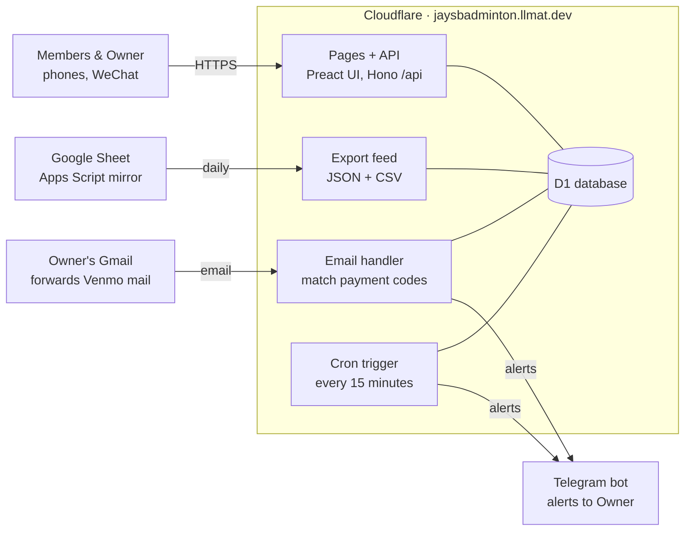
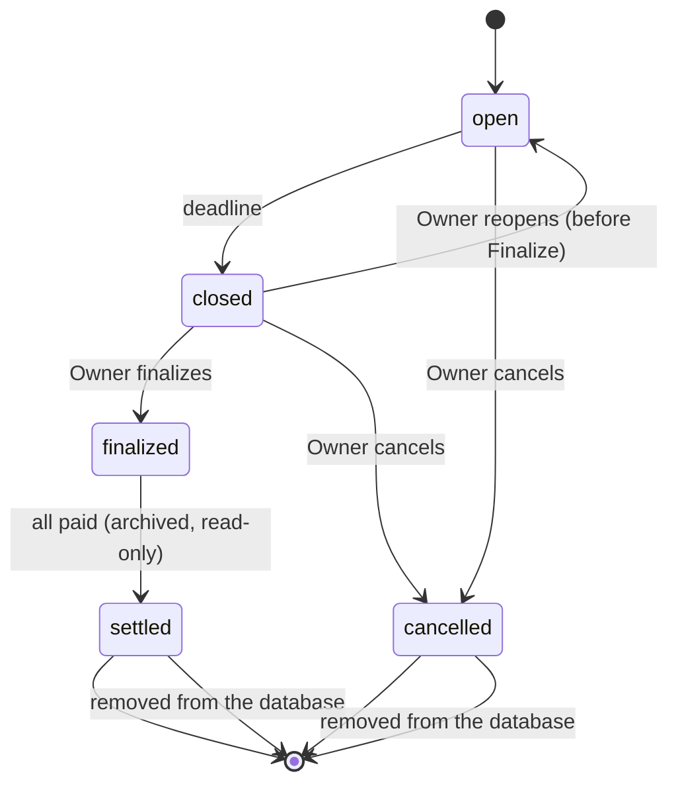

# Jay's Badminton — Technical Design

> Kept up to date with the code in this repository. Requirements (Chinese): [requirements.zh.md](requirements.zh.md). Google sign-in setup (Chinese): [google-login.zh.md](google-login.zh.md).

Oct 1, 2026 (updated Oct 3, 2026) · @Ke Li

The whole system runs on Cloudflare's free tier at jaysbadminton.llmat.dev: Workers serves the pages and API, D1 stores the data, Cron Triggers run reminders, and Email Routing receives forwarded Venmo emails for instant payment matching. A small Google Apps Script mirrors the data into a Google Sheet once a day. This document implements the requirements document (Chinese) without changing its rules.

## Architecture



One Cloudflare Worker serves the pages and API, receives forwarded Venmo emails and runs the cron every 15 minutes; each event also has a Durable Object alarm for its deadline. All of them share one D1 database. Telegram alerts come from both the cron job and the email handler. Google sees only the forwarded Venmo emails and the daily export the Sheet pulls.

## URLs and routing

One Worker answers everything on `https://jaysbadminton.llmat.dev`: page paths return the single-page app, `/api/*` returns JSON. All pages are Chinese and mobile-first.

| Path | Audience | What it shows |
| --- | --- | --- |
| `/` | Public | Open and recent events, past events, attendance leaderboard, 登录 / 注册 |
| `/join` | Public | 用邮箱注册: username, WeChat name, optional note, email typed twice; the link is emailed on approval |
| `/recover` | Public | 找回我的专属链接: emails the link again to a member's address |
| `/e/{code}` | Public | One event: time, place, deadline, headcount, calendar links; never names. A member signed in with Google sees their own card instead (roster, sign-up, bill) |
| `/login`, `/me`, `/me/profile` | Member (Google) | 登录 / 注册 (Google, or a link to `/join` and `/recover`) and Google sign-in; first time: apply (pending) or link an existing member; then 我的活动 and 个人信息, also reachable from the avatar menu |
| `/m/{memberToken}`, `/m/{memberToken}/profile` | Member (link) | 我的活动: their own events newest first (sign-up with friends, roster, amounts owed + Venmo button), events open to join, and 历史活动 (over and paid up, folded). 个人信息: spending chart, profile (email, join time, activity heatmap), rename, link Google |
| `/admin` | Public | First-time setup while no admin link exists; afterwards a pointer to the link and the Google way in |
| `/admin/{adminToken}`, `/admin/google` | Owner | Approvals, members (profiles, 备注名), events, roster edits, 我的报名, settlement, payment board, 待确认 Venmo payments, settings, exports |
| `/api/...` | Mixed | JSON API (see API) |
| `/export/{key}/all.json` | Owner (export key) | The JSON feed for the Google Sheets mirror (CSV downloads go through the admin API) |

- `{code}` is the event code from the requirements: the event's date when it was created, as MMDD (`1006`), with a letter suffix for a later event created for the same day (`1006B`). It comes from the event's fixed number (`jbm20261006`, `jbm20261006b`; see Event number) and does not change when the date is edited. Only the number is unique: codes repeat from one year to the next, and events that shared a number before migration 0021 kept their old codes, so the public page opens the matching event with the latest start time.
- Unknown or revoked tokens show a neutral "链接无效，请联系管理员" page with no detail.
- Everything the Worker answers (`/`, `/e/*`, `/api/*`, `/export/*`, `/robots.txt`) sends `Cache-Control: no-store` and `Referrer-Policy: no-referrer`, so tokens are not cached or leaked to Venmo or other sites. The other pages, `/m/*` and `/admin/*` included, are the static app shell served by Cloudflare with `src/web/public/_headers`: it sets `Referrer-Policy: no-referrer` and the other security headers, but not `Cache-Control: no-store`. The shell holds no token or member data; those come from `/api`.

## Identity and security

Nobody has a site password except the Owner. A member is identified either by the secret token in their link (delivered privately over WeChat) or by their Google account. The Owner is a member with the `is_owner` flag (exactly one, the person who ran first-time setup); the admin page takes the admin link plus a password, or the Owner's own Google account once bound.

- **Google sign-in** (`src/worker/googleAuth.ts`, setup in [google-login.zh.md](google-login.zh.md)): Authorization Code + PKCE, state and nonce; the ID token is verified against Google's keys and the stable `sub` is the identity. A random session id is kept hashed in `member_sessions` behind an HttpOnly, SameSite=Lax cookie (30 days); cookie-authenticated writes check `Origin`. `/api/auth/google?next=` returns only to this site's `/me` or `/admin/...` pages.
- **One Google account per person**: `members.google_sub` has a unique index, so an account belongs to at most one member and a member (the Owner included) holds at most one account. A newcomer who applies with Google is `pending` until approved (and counts toward the 30-pending cap); approving them issues no link, since they sign in. An existing member links Google by confirming their old link. Deleting a member releases the account.
- **Admin by Google**: 设置 → 用 Google 登录管理页 binds the account signed in on that browser to the Owner's member record (refused when that account already belongs to someone else, or when the Owner already has one). `/api/admin/google/*` is then allowed for that session only, with an `Origin` check on writes; changing the password and resetting all data still ask for the password.

- **Tokens**: 32 random bytes from `crypto.getRandomValues`, base64url (43 characters). D1 stores a SHA-256 hash for lookup plus the token encrypted with AES-GCM under a key held as a Worker secret (TOKEN\_KEY). Exports and the Sheets mirror never include either column.
- **Showing a link again**: the admin page decrypts the stored token to show the member's link and QR code again, as the requirements ask. **Regenerate** issues a new token and the old one stops working at once.
- **Admin token**: a separate token for `/admin/{token}`, plus a password. The first visit to `/admin` (while no admin link exists) asks for the password and creates the admin link and the Owner's member record. A lost link is reset by running the deploy workflow with `reset_admin_link` (on the latest release tag for production, on `main` for the test site, whose password is `ADMIN_PASSWORD_STAGING`), which reopens first-time setup. The admin API needs both the link and a session cookie (HttpOnly, Secure, SameSite=Strict, path `/api/admin`, 30 days) obtained with the password. The password hash is PBKDF2-SHA256 over an HMAC peppered with `TOKEN_KEY`, with few iterations to fit the 10 ms CPU limit. Changing it in settings signs every device out. The `ADMIN_PASSWORD` GitHub secret is pushed to the Worker on every deploy; when its value changes, the stored hash resets to it and all sessions end (the forgotten-password path). `TOKEN_KEY` is generated once by CI and never replaced: it encrypts member links, the admin link and the Sheets export key (`export_key_enc`), and the password pepper and Telegram webhook secret are derived from it, so losing it also means re-showing the Sheets script and reconnecting Telegram. 设置 → 备份网站密钥 (password required) sends it to the Owner's Telegram, never to the browser, to be saved as the GitHub secret `LINK_ENCRYPTION_KEY` (`LINK_ENCRYPTION_KEY_STAGING` for the test site). Every deploy checks that the backup still decrypts the stored admin link (the check runs after `wrangler deploy`, so a mismatch fails the job with the new version already live, and the `reset_admin_link` step and smoke test are skipped), and if the Worker has lost `TOKEN_KEY`, the backup is put back instead of a new key being generated (`scripts/sync-secrets.mjs`).
- **Export key**: a third independent token, used only by the Apps Script mirror for `GET /export/{key}/all.json` (CSV downloads go through the admin login). Regenerable from settings.
- **Member IDs**: `M001`, `M002`, … assigned on join request, never reused or changed. Used in payment codes and as the stable key everywhere.
- **Authorization**: every member handler resolves the token (or Google session) first and only reads or writes rows for that member; the admin link or bound Google session unlocks admin endpoints. A deactivated member's link (and Google) still opens their page so they can pay what they owe, but cannot sign up; a deleted member's link stops working.
- **Abuse limits**: the join form has a hidden honeypot field, and at most 30 requests can wait for approval at once (more are refused until the Owner clears some), so a flood cannot grow without bound. There is no per-IP rate limit; if the site is ever flooded, add Cloudflare's free rate-limiting rule for `/api/public/join` and `/api/auth/register`. Usernames are unique case-insensitively and limited to 20 characters. Deleting a member frees their name: the old record keeps it with the member ID appended (`Alice（M004）`), so history and rankings never mix two people up.
- **Links by email**: approving a member who registered with email sends their link through Resend (`RESEND_API_KEY`, `EMAIL_FROM`; Idempotency-Key `member-approval/{id}/{approved_at}`), recorded in `approval_email_status`; the Owner can retry or still copy the link. `POST /api/public/recover-link` mails an approved member's link again (Google-only members get sign-in instructions), at most once an hour per member (`link_resent_at`), and answers `{ ok: true }` whether or not the address is known, so it cannot be used to find members. Addresses are unique case-insensitively across `email` and Google members' `google_email`.
- **Secrets** (Telegram bot token, export key hash, etc.) live in D1 settings or Worker secrets (`wrangler secret put`), never in the repository.
- **Security headers**: the Worker sets them in `src/worker/index.ts` and `src/web/public/_headers` repeats them for static pages. The CSP and `Strict-Transport-Security: max-age=31536000` (no `includeSubDomains` or `preload`) come from `src/shared/security.ts`, and `test/security.test.ts` checks that `_headers` matches for those two only. `X-Content-Type-Options: nosniff`, `X-Frame-Options: DENY`, `Referrer-Policy: no-referrer` and a `Permissions-Policy` that turns off camera, microphone, geolocation and payment are written out in both files and nothing checks that they agree. The Content Security Policy is (`default-src 'self'`, Google profile pictures and `data:` images allowed, `frame-ancestors 'none'`). The CSP is report-only for now: browsers post violations to `POST /api/csp-report`, which logs the first 2,000 bytes of each report to the Worker logs and blocks nothing. Switch the header to `Content-Security-Policy` once the logs stay quiet.
- **Known accepted risk**: anyone holding a member link can act as that member (as stated in the requirements).

## Data model

D1 (SQLite) holds the tables below. Money is stored as integer cents, times as UTC ISO strings and shown in America/Los\_Angeles. Schema changes ship as numbered migrations in `migrations/`.

| Table | Key columns | Notes |
| --- | --- | --- |
| `members` | `id` (M001), `username` (unique, NOCASE), `wechat_nickname`, `status` (pending / active / inactive), `token_hash`, `token_enc`, `is_owner`, `requested_at`, `approved_at`, `deleted_at`, `google_sub` (unique), `google_email`, `email` (their own contact email; set at 用邮箱注册, one member per address), `approval_email_status`, `approval_email_sent_at`, `link_resent_at` (last 找回 email), `admin_note` (备注名, Owner only) | Rejected requests are deleted; the next ID is never reused; deleted members keep their history under `name（ID）` |
| `events` | `id`, `number` (活动编号 jbm20261006, jbm20261006b: fixed at creation, unique, never reused), `code` (1006, 1006B), `title`, `date`, `start_at`, `end_at`, `location`, `address`, `deadline_at`, `deadline_offset_min`, `status` (open / closed / finalized / settled / cancelled), `finalized_at`, `settled_at`, `dunning_stopped`, `created_at` | `settled` = all paid and archived; read-only from then on |
| `registrations` | `id`, `event_id`, `member_id`, `friend_index` (0 = the member), `friend_name`, `attended` (default 1), `added_by_owner`, `created_at`, `updated_at` | Friends hang off the member who pays for them; Owner-added walk-ins ignore the friend cap, and a member may keep friends already on their list above the cap but not add more |
| `settlements` | `event_id`, `court_total_cents`, `shuttle_count`, `shuttle_price_cents`, `registered_count`, `attended_count`, `court_share_cents`, `shuttle_share_cents`, `finalized_at` | One row per event; recomputed on every edit before archive |
| `deleted_events` | `id`, `number`, `code`, `date`, `deleted_at` | What 从数据库永久删除 keeps, so the number is never handed out again and a late payment for it goes to 待确认 (migration 0019; `number` from 0021) |
| `payments` | `event_id`, `member_id`, `amount_due_cents`, `payment_code` (xiaoming-jbm20261006-m007), `status` (unpaid / partial / paid), `amount_paid_cents` (net: payments minus refunds), `refunded_cents` (total refunded), `paid_at` | One row per paying member per event; friends roll up here. Both amounts are derived from the receipts; the bill is paid when the net reaches `amount_due_cents` |
| `payment_receipts` | `payment_id`, `amount_cents`, `method` (venmo / manual / refund), `venmo_txn_id` (unique), `payer_name`, `received_at`, `note` (an auto-matched Venmo payment's note), `inbound_id` (the 待确认 row it was linked from) | Every payment toward a bill, and every refund as a negative row (`refund`, migration 0018); a bill can be paid in several pieces. `note` and `inbound_id` (migration 0022) let 撤销 send a Venmo payment back to 待确认 |
| `inbound_payments` | `venmo_txn_id` (unique), `email_id`, `payer_name`, `amount_cents`, `note`, `received_at`, `kind` (unmatched = 待确认), `state` (open / linked / ignored / deleted), `linked_payment_id`, `reason`, `deleted_from` (state to restore), `deleted_at` | Venmo payments with our code that the Owner reviews; unrelated payments are not stored. `deleted` is the 已删除 trash (migration 0020), purged by the cron after 30 days |
| `locations` | `name`, `address`, `last_used_at`, `use_count` | Feeds the venue picker (最近的场馆, last 10); ✕ forgets a venue, while events keep their own copy |
| `settings` | `key`, `value` | Friend cap N, site title, theme, leaderboard on/off, Venmo username and notification email, Zelle account, Telegram chat ID, reminder on/off + hours, dunning hour, weekly digest on/off, last shuttle price, last event times and venue, last deadline offset, admin/export token hashes |
| `notification_log` | `event_id`, `type`, `sent_on` (Pacific date), `sent_at` | Unique on (event, type, sent\_on) so a retried cron run never double-sends; site-wide notices use `event_id = 0` |
| `email_log` | `received_at`, `outcome` | One row per Venmo email outcome, for health alerts and the weekly digest; pruned after 120 days |
| `admin_sessions` | `id_hash`, `created_at`, `expires_at` | Password logins (30 days) |
| `member_sessions` | `id_hash`, `google_sub`, `email`, `picture`, `expires_at` | Google sign-ins (30 days) |
| `oauth_states` | `id_hash`, `nonce`, `verifier`, `expires_at` | One per Google sign-in in progress; consumed by the callback, 10 minutes |

Payments for the Owner and the Owner's friends are created as `paid` with method `manual` at Finalize; on every recompute that receipt is redone at the new amount, so the Owner's bill stays paid. The "collected" check counts rows that are not `paid`; it never compares totals.

## API

JSON over HTTPS under `/api`, grouped by who may call it. Tokens travel in the path segment the page already has, never in query strings. Writes are POST; all inputs are validated server-side.

| Audience | Endpoints |
| --- | --- |
| Public | `GET /api/public/site`, `home` (open events, past events, leaderboard), `events/{code}`, `events/{code}/calendar.ics` · `POST /api/public/join`, `recover-link` · `GET/POST /api/public/admin-setup` |
| Google (`/api/auth/…`) | `GET session`, `google` (start, optional `next`), `google/callback` · `POST register` (apply, pending), `link` (bind an existing member's link), `logout` |
| Member (`/api/m/{token}/…`, or `/api/m/session/…` for Google) | `GET me`, `events` (my events with roster, bill and payment), `stats`, `profile` · `POST rename`, `email`, `events/{id}/signup` (friend names), `events/{id}/cancel` |
| Owner (`/api/admin/{token}/…`, or `/api/admin/google/…`) | Session: `POST login`, `logout` · Members: `GET members`, `members/{id}/link`, `members/{id}/profile` · `POST members/{id}/approve`, `approval-email` (retry), `reject`, `regenerate`, `deactivate`, `reactivate`, `delete`, `note` · Events: `GET/POST events`, `GET events/defaults`, `events/{id}` · `POST locations/remove`, `events/{id}/edit`, `close-now`, `cancel`, `delete` (password; settled or cancelled only), `reopen`, `self-signup`, `self-cancel`, `roster/add`, `roster/{rid}/rename`, `roster/{rid}/remove` · Settlement: `GET events/{id}/settlement` · `POST events/{id}/attendance`, `preview`, `finalize`, `dunning` · Payments: `POST payments/{id}/mark-paid`, `payments/{id}/refunded`, `receipts/{id}/remove` · 待确认: `GET inbound` · `POST inbound/{id}/link`, `ignore`, `delete`, `restore`, `purge`, `inbound/trash/clear` (password) · Telegram: `GET telegram` · `POST telegram/connect`, `test`, `disconnect` · Settings: `GET/POST settings` · `POST settings/payment` (password), `settings/password`, `settings/backup-key` (password), `settings/rotate-admin`, `settings/reset` (password + phrase) · `GET settings/google` · `POST settings/google/bind`, `unbind` · Sheets: `GET sheets` · `POST sheets/enable` (new key), `sheets/disable` · `GET export/{table}.csv` · `GET places?q=`, `places/{id}`, `email-status` |
| Other | `GET /api/health` (database reachable; used by the smoke test) · `POST /api/csp-report` · `POST /api/telegram/webhook` (secret-token header) |
| Export (`/export/{key}/…`) | `GET all.json` (Sheets mirror) |

- Every Owner write on an event checks its status first: roster and settlement edits are refused once the event is `settled`, matching "archived means read-only".
- Errors return `{ error: { code, message } }` with a Chinese `message` the page shows as-is.

## Event lifecycle



Each handler that moves an event checks its current status first (`src/worker/events.ts`, `routes/adminEvents.ts`, `billing.ts`), and every roster or settlement edit is refused once the event is `settled`, so the archive lock holds for every endpoint (covered by tests). `closed` is set at the deadline by the event's Durable Object alarm (see Scheduled jobs); as a backstop, `closeExpired` also closes every open event past its deadline on each cron run, when an alarm fires, and in these routes: member `events/{id}/signup` and `cancel`; Owner `events/{id}/self-signup`, `self-cancel`, `close-now`, `edit`, `reopen`, `preview`, `finalize`, and `members/{id}/deactivate`. `settled` is set the moment the last unpaid payment flips to paid. Once an event has ended without Finalize, the Owner gets an hourly reminder; an ended event with nobody on the roster cannot be finalized, so it gets one note suggesting 取消 instead. Removal is not a status: 从数据库永久删除 (password, settled or cancelled events only) removes the event with its roster, bills, receipts, linked Venmo payments and notification log in one batch, clears its alarm, and keeps only its id, number, code and date in `deleted_events`. Stopping dunning sets a flag on a `finalized` event and does not change its status.

## Settlement and payment codes

Settlement is one pure function, `settle(roster, inputs)`, shared by preview and Finalize and covered by unit tests, including the example from the requirements (24 registered, 22 attended, $240 courts, 20 shuttles at $3 → $12.73 and $10.00).

```latex
\text{court share} = \left\lceil \frac{\text{court total}}{\text{registered}} \right\rceil_{\text{cent}} \qquad \text{shuttle share} = \left\lceil \frac{\text{shuttles} \times \text{price}}{\text{attended}} \right\rceil_{\text{cent}}
```

1. Count every roster row (members and friends) as registered; count rows with `attended = 1` as attended.
2. Work in integer cents and round each share **up** with integer math (`Math.ceil(a / b)` on cents), so floating point never under-charges.
3. Each row owes the court share, plus the shuttle share if attended. A member owes the sum of their own row and their friends' rows.
4. On every change before archive (roster, attendance or fees on a finalized event), recompute `amount_due_cents` for every bill, `paid` ones and the Owner's included, then each bill's net received and status from its receipts: a member who already paid ends up `partial` (owing the difference) or with an excess to refund. For a member no longer on the roster (`applySettlement`), a bill with status `unpaid` is deleted together with all its receipts; that includes a bill that was paid and then fully refunded (net 0), so its payment and refund records go too. A bill that is `partial` or `paid` stays at $0 due, so everything received is listed for refund. The Owner's bill is deleted whatever its status.
5. The settle card warns (on the card and in the Finalize confirmation) when nobody is marked as attended but there is a shuttle cost, since that cost is then split among nobody and dropped.

**Event number**: every event gets a 活动编号 when it is created, `jbm{yyyymmdd}` from its date, or `jbm{yyyymmdd}{b…z}` for a later event created for the same day (`events.number`, unique index). It never changes, even when the Owner edits the date, and is never handed out again: a new event skips every number already held by an event (wherever its date has moved since) or a deleted one (`deleted_events.number`). The public code (`1006B`) is derived from it.

**Payment code**: `{name}-{event number}-m{member number}`, all lowercase, e.g. `xiaoming-jbm20261006-m007`. The name is the username in toneless pinyin (pinyin-pro) or lowercase Latin with spaces as underscores. It is generated at Finalize and never changed by renames or date edits. Incoming notes are matched on the event number and member number (the code printed on a bill first, then the event's number); the name must belong to someone in the group and to the bill.

**Venmo button**: a link to `https://venmo.com/{owner}?txn=pay&amount={amount}&note={code}` (the current web pay link; the exact format is verified on a real phone before launch, since Venmo has changed it before). The page also prints the username, amount and code as plain text, the Zelle account, and the hint to open in the system browser when WeChat blocks the link.

## Venmo email ingestion

A Gmail filter forwards only mail from `venmo@venmo.com` to `venmo@jaysbadminton.llmat.dev`; Cloudflare Email Routing hands each message to the Worker's `email()` handler, which matches it within seconds. The Worker never has access to the Owner's mailbox.

1. **Accept or drop**: the From address must be `venmo@venmo.com` and the subject must read `… paid $X.XX to your Venmo account`; anything else is dropped silently (never bounced). The Worker then verifies Venmo's own DKIM signature itself (`d=venmo.com`, rsa-sha256, From, To and Subject signed, exactly one of each, no `l=`), fetching the public key over DNS-over-HTTPS (Cloudflare, falling back to Google). Each lookup has a 5-second timeout; a timeout, network error, HTTP error or SERVFAIL moves on to Google, while any other answer (including no key) is final, so a forged selector is still rejected. Gmail forwarding and Email Routing only add headers on top, so the signature survives; this was checked against a real forwarded receipt. A forged "Venmo" email sent straight to the address fails here and is dropped. If DNS is unreachable the email is never auto-marked (see step 4).
2. **Parse** the HTML body (Venmo receipts carry an empty text part): HTML is flattened to lines, then the field rules in the requirements apply: payer before `paid you`, the amount after it (Venmo splits `$7.00` across several elements, so the pieces are joined and cross-checked against the subject), note up to `Money credited to your Venmo account.`, then the `Date`, `Transaction ID` and `Sent to` values. `Sent to` must equal the configured Venmo username and the signed `To` header must be exactly the configured Venmo notification email (the address on the Venmo account; required together with the username in settings), otherwise the email is ignored. `Delivered-To` is not used: Gmail adds it and it is not signed.
3. **De-duplicate** on the Venmo transaction ID; a second copy is ignored.
4. **Match**: the Owner forwards every Venmo receipt, most unrelated to badminton, so only notes matching `/([a-z0-9_]+)\s*-\s*jbm\s*(\d{8})([a-z]?)\s*-\s*m(\d+)/i` whose name part belongs to a group member (current username in pinyin, or the name printed on any bill) and whose `jbm` part is an existing event's number (`events.number`; a deleted event's number in `deleted_events` sends the payment to 待确认) are acted on. The bill is looked up first by the code printed on it (this member's bill whose code holds that number, since bills made before migration 0021 may carry a date other than their event's number), then through the event with that number:
   - the member has a bill on that event and the name is the one printed on the bill (fixed when the bill is created; renames do not change it) → add a `payment_receipts` row (amount, transaction ID, payer) and recompute the bill: total < due → `partial`, total ≥ due → `paid` (run the "all collected?" check), total > due → the excess is listed under 需要退款 until the Owner marks it refunded. This also applies to archived events, which can only gain an over-payment;
   - the event exists but the bill cannot be pinned down (no bill for that member number, name and number are different people, event not settled yet, or cancelled) → `inbound_payments` kind `unmatched` with a reason, shown under 待确认, notify the Owner;
   - anything else (no code, no name, unknown name or event, unparseable email) → ignored and not stored.
   - If DNS was down and the signature could not be checked, an email that would otherwise be acted on goes to 待确认 instead; it is never auto-marked.

The admin page's 收款 tab lists the 待确认 rows with their reason; the Owner links one to an open bill (adds a `venmo` receipt of that amount, with `inbound_id` pointing back) or ignores it. 待确认 and ignored rows can be deleted to 已删除 (`state = 'deleted'`), restored from there, or purged one by one; 清空 needs the password, and the cron purges anything deleted more than 30 days ago. Exports show the state as 已删除.

**Undoing a payment** (撤销 on a receipt, before archive): a manual receipt is simply deleted. A Venmo receipt goes back to 待确认 so the money is never lost: the 待确认 row it was linked from (`inbound_id`, or the same transaction ID for older receipts) reopens from any state with the reason 从账单撤销的 Venmo 付款 (the old reason kept in brackets), and an auto-matched payment, or one whose row is gone, gets a new 待确认 row with its payer, amount, note and time. The bill is then recomputed from its remaining receipts.

**Gmail forwarding confirmation**: while the Owner adds the forwarding address, Email Routing temporarily forwards that address to the Owner's Gmail so Google's confirmation link arrives; the route is switched to the Worker before the Gmail filter is created, avoiding a forwarding loop. The sample email from the requirements becomes the first parser test fixture.

## Scheduled jobs and Telegram notifications

Each event has a Durable Object (`DeadlineAlarm`, `src/worker/deadlines.ts`) whose alarm is set for its 截止前提醒 and then its deadline, so 报名截止 goes out the moment sign-up closes. The alarm is re-aimed whenever the deadline can change: create, edit, close early, reopen, cancel, and a change to the reminder settings; every cron run also re-aims the alarms of all open events, so events created before alarms existed get one. One Cron Trigger runs every 15 minutes (`*/15 * * * *`, UTC) for the hourly and daily jobs and as a backstop for a failed alarm; the handler converts "now" to Pacific time and walks every non-archived event. Each notification is written to `notification_log` before sending, so a retry never sends twice.

| Job | Fires when | Repeats |
| --- | --- | --- |
| Deadline reminder | `deadline_at − reminder hours ≤ now < deadline_at`, reminders on, event created before that window | Once per deadline (again after a reopen) |
| Close sign-up | `now ≥ deadline_at` and status `open` → status `closed`, send roster summary | Once per deadline |
| Settle reminder | `now ≥ end_at` and status `closed`, 08:00–22:00 Pacific | Hourly (log key = Pacific date + hour); an event with nobody signed up gets one note suggesting 取消 instead |
| Daily dunning | `now ≥ finalized_at + 24 h`, local hour = dunning hour, someone unpaid, dunning not stopped | Daily: one summary + one message per unpaid member |
| All collected | Triggered inline whenever a payment flips to paid (email or manual) and none remain | Once, then the event is archived |
| Payment needs review | Inline from the email handler (待确认, partial payment, over-payment to refund) | Per email |
| Forwarding watch | At the dunning hour: bills out ≥ 3 days and no Venmo email for ≥ 3 days | Once per quiet spell |
| Weekly digest | Mondays at the dunning hour, setting `weekly_digest` on | Weekly |
| Empty the trash | Every run: 已删除 Venmo payments deleted more than 30 days ago are removed | Every run |
| Re-aim alarms | Every run: each open event's Durable Object alarm is set again | Every run |

**Telegram**: `POST https://api.telegram.org/bot{token}/sendMessage` to the Owner's chat ID with `parse_mode: HTML`. Each message has the Owner's details first, then a divider and the text to paste into WeChat inside a `<pre>` block so one tap copies it. Per-person dunning messages are separate Telegram messages so each can be forwarded to a private chat on its own. The bot token is a Worker secret (`TELEGRAM_BOT_TOKEN`, from the GitHub secret of the same name); the chat ID is a setting. A failed send removes its log row so the next run retries.

**Binding the Owner's chat**: 设置 → 连接 Telegram calls `getMe` and `setWebhook` (`/api/telegram/webhook`, with a `secret_token` derived from `TOKEN_KEY` that Telegram echoes in `X-Telegram-Bot-Api-Secret-Token`), then returns `t.me/<bot>?start=<code>`. The code is random, stored hashed, single-use and valid for 10 minutes. The webhook acts only on `/start <valid code>` from a private chat, which stores that chat as the only recipient; everything else is ignored. Settle reminders are quiet from 22:00 to 08:00 Pacific.

**Admin link recovery**: the admin token is stored hashed and AES-GCM encrypted under `TOKEN_KEY`. 「管理页面」 or `/admin` from the bound chat (and only that chat) gets the current link; a link issued before encryption existed is replaced by a new one. **Gmail forwarding confirmation**: mail from `forwarding-noreply@google.com` with a valid google.com DKIM signature is passed to the Owner's Telegram, so the Owner can confirm the forwarding address without help. The last Venmo/Gmail email's time and outcome are kept in settings and shown in the admin guide as 转发状态.

## Address suggestions

The venue form's 地址 field asks our own endpoint (`GET /api/admin/{token}/places?q=`), so no key reaches the browser. With the `GOOGLE_MAPS_API_KEY` secret set it uses Google Places (New) Autocomplete, restricted to the US and biased to Northern California (36°–42°N, 124.5°–119°W); picking a suggestion fetches only `formattedAddress` with the same session token, so a whole search is billed as one session and stays within Google's free monthly calls. Every outside request has a 4-second timeout. Without the key, or if Google refuses or times out (quota, key problem), it falls back to Photon (OpenStreetMap): Northern California first, then the rest of the US. The page waits 250 ms after typing, shows 搜索中…, and caches repeated queries.

## Appearance

Two styles (`minimal`, `aurora`) × four accents each, light and dark. `src/shared/themes.ts` lists them as `style-accent` ids (`minimal-coral` is the default); `styles.css` keys every colour off `data-style`, `data-accent` and `data-mode` on `<html>`. The Owner's choice is the `theme` setting (old palette names map to the nearest new id). A visitor's own choice and their light/dark/auto mode live only in `localStorage` (`my-theme`, `my-mode`); `index.html` applies them before first paint. Colours are plain values or `rgba(var(--triplet), a)` — no `color-mix()` — so older WeChat WebViews render them. Fonts: Geist and Geist Mono (Latin only, bundled); Chinese uses the system font.

## Health alerts and weekly digest

`src/worker/health.ts`. Every Venmo email outcome is logged in `email_log` (outcome and time only; pruned after 120 days). A parse failure, a bad signature or a wrong recipient alerts the Owner at once (once a day per kind). At the bill-reminder hour the cron checks for a quiet spell: bills out ≥ 3 days, no Venmo email for ≥ 3 days → one alert per spell (keyed by the last email time). On Mondays at that hour it sends the weekly digest (switchable, setting `weekly_digest`). A scheduled run that throws records `cron_last_error[_at]` for the digest. Site-wide notices use `event_id = 0` in `notification_log`, since NULL would not de-duplicate.

## Link previews, calendar and icon

The Worker runs first for `/` and `/e/*` (`run_worker_first`), fetches the app shell from `ASSETS` and rewrites `<title>`, `description` and `og:*` with HTMLRewriter (`src/worker/share.ts`): event title, date, time, venue, headcount, deadline — never names. `GET /api/public/events/{code}/calendar.ics` serves an RFC 5545 file (UTC times, folded lines, 2-hour alarm); the page also links a prefilled Google Calendar URL (`src/shared/calendar.ts`). Icons, `manifest.webmanifest` (no `start_url`, so a member's home-screen shortcut opens their own page) and the share image live in `src/web/public`. The home page has a 生成分享名片 button for the site, and every event card (public page and the member's own) has one action row with the 加入日历 buttons and, while sign-up is open, 分享名片 (`EventActions`): `src/web/ShareCard.tsx` draws a PNG in the browser (canvas) with `/icon.svg`, the site title, the event's date, time and venue (`src/shared/shareCard.ts`, never names), a QR code and the link, for long-press saving or download.

## Google Sheets daily mirror

The site never logs into Google. 设置 → Google 表格同步 → 开启同步 creates an export key (stored hashed to check requests, and AES-GCM encrypted under `TOKEN_KEY` so the page can show the script again) and shows a ready-to-paste Apps Script with the site address and key filled in (`src/worker/sheets.ts`). The Owner pastes it into the sheet's Apps Script editor and runs `install` once.

- **Pull**: `sync()` fetches `GET /export/{key}/all.json` and rewrites one tab per table (成员, 活动, 报名, 结算, 应付款, 付款明细, 待确认收款, 场馆), header row frozen and bold, plus a 同步记录 tab with one line per run. Edits in the sheet never flow back.
- **Trigger**: `install()` replaces any previous trigger with one daily run at 03:00 America/Los_Angeles, then syncs once.
- **History**: Google Sheets keeps version history (文件 → 版本记录), so each day's sync can be looked up there; D1 Time Travel covers the last 7 days on the Cloudflare side.
- **Key**: 重新生成密钥 replaces the key immediately (the old script gets 403 and says so); 关闭同步 deletes it. The admin page shows the last time the sheet pulled.
- **Permissions**: the script asks for "see and edit this spreadsheet", "connect to an external service" and "run when you are not present"; no Gmail or Drive scope. The Owner sees Google's unverified-app warning once and continues via 高级.
- **Content**: the same people-friendly tables as the CSV downloads (`src/worker/export.ts`): Chinese headers, Chinese status names (a trashed Venmo payment shows as 已删除), dollars, Pacific times, event numbers like `jbm20261007b`. Tokens, hashes and settings are never exported.

**CSV downloads**: 设置 → 导出数据 offers each table as a UTF-8 CSV with a BOM (`GET /api/admin/{token}/export/{table}.csv`, behind the admin login) (so Excel shows Chinese correctly); cells starting with `= + - @` are prefixed so spreadsheets do not run them as formulas.

**Statistics** (`src/worker/stats.ts`): attendance follows the Owner's 到场 marks on finalized or archived events. The public leaderboard (active members only, so deactivated and deleted members are left out; no money) ranks this year's attendance, the longest run of consecutive events attended, and friends brought this year. The member page shows this year's and all-time visits, this year's spending (their bills, friends included), the average per visit, and the same period last year.

## Repository, tooling and deployment

One TypeScript repository (`likefudan/jaysbadminton`) builds one Worker that serves both the static front end and the API; every merge to `main` deploys the test site (`env.staging`: Worker `jaysbadminton-staging`, its own D1 and domain `staging.jaysbadminton.llmat.dev`, its own Telegram bot); production deploys only from a `v*` release tag on `main`, after exporting its database. The `Release` workflow (run by hand on `main`) picks the next `vYYYY.MM.DD[.N]` tag in Pacific time, refuses a commit whose CI on `main` is not green or that is already tagged, publishes a GitHub release with generated notes, and starts `ci.yml` on the tag (a tag created with the workflow token fires no push run of its own).

| Part | Choice | Why |
| --- | --- | --- |
| Runtime | Cloudflare Workers with static assets | Pages, API, cron and email in one deployable |
| Router | Hono | Small, typed, built for Workers |
| Database | D1 + SQL migrations via Wrangler | Free, SQLite, versioned schema |
| Front end | Preact + Vite, Chinese UI, no CSS framework, self-hosted Geist fonts | Small bundle for slow WeChat in-app browsers |
| QR codes | `qrcode` npm package, rendered in the browser | Owner long-presses to save, as required |
| Email parsing | `postal-mime` | Standard MIME parser for Email Workers |
| Tests | Vitest + `@cloudflare/vitest-pool-workers`; Playwright browser tests (`e2e/`) | Unit/integration against a real local D1; browser tests drive the main flows on a local Worker with a fresh database (`scripts/e2e-server.sh`) |
| CI/CD | GitHub Actions: lint (Biome), typecheck, test, build, browser tests; `main` → staging, `v*` tag → production (tag-on-main check, D1 export artifact, migrations, deploy, secret sync, smoke test); re-running on an older tag rolls back; Dependabot opens monthly grouped update PRs | Uses a `CLOUDFLARE_API_TOKEN` repository secret |

```text
docs/            requirements (Chinese), this design, Google sign-in setup, launch checklist
migrations/      D1 schema, numbered SQL files
src/shared/      types, settlement, times, themes, calendar (used by both sides)
src/worker/      Hono API, cron handler, email handler, Google sign-in, settlement, Telegram
src/web/         Preact pages: home, join, event, login / me, member, admin
test/            unit + integration tests, Venmo email fixtures
e2e/             Playwright browser tests
scripts/         CI helpers (D1 lookup, secret sync, smoke test, e2e server)
wrangler.jsonc   bindings: DB, ASSETS, cron, email; env.staging for the test site
```

**Test focus**: settlement math and rounding, status transitions and the archive lock, deadline/reminder timing across daylight-saving changes, payment-code matching, and the Venmo parser against real (redacted) emails.

**Environments**: local development with `wrangler dev` and a local D1; the test site (`staging.jaysbadminton.llmat.dev`, `env.staging`: its own Worker, D1, Telegram bot and admin password `ADMIN_PASSWORD_STAGING`, a yellow 测试环境 banner, `noindex`) deployed on every merge to `main`; production deployed from `v*` release tags.

## Free-tier budget

Expected use is a few hundred requests a day, far inside Cloudflare's free plan. The limits below were checked against the Cloudflare Workers and D1 limits and pricing pages on 2026-10-01. The one that shapes the code is 50 D1 queries per invocation: handlers batch their statements.

| Resource | Free limit | Expected use |
| --- | --- | --- |
| Worker requests | \~100,000 / day | A few hundred / day, plus 96 cron runs |
| CPU per invocation | \~10 ms | Low single-digit ms for API calls, settlement and email parsing |
| Cron Triggers | \~5 per account | 1 |
| Durable Objects (SQLite) | Free-plan daily request and duration limits (see Cloudflare's pricing page) | One per event; a few alarm runs and syncs per event, plus one sync per open event every cron run |
| D1 storage | 5 GB total, 500 MB per database | Under 1 MB per year |
| D1 reads / writes | \~5M rows read, \~100k rows written per day | Thousands at most |
| D1 Time Travel | \~7 days of point-in-time restore | Backup; daily Sheets snapshots add 30 days |
| Email Routing | Free; each email runs the Worker | A few dozen emails / week |
| Static assets | Not billed as Worker requests | All page loads |

On the free plan, exceeding a limit makes requests fail rather than adding charges, so there is no surprise bill. The only paid item is the domain, which the Owner already has.

## Owner setup checklist

The Owner does these once, in this order; steps marked *after deploy* wait until the Worker is live.

- [x] Enable Email Routing for the `jaysbadminton.llmat.dev` subdomain and verify the Gmail destination
- [x] Create `venmo@jaysbadminton.llmat.dev`, temporarily forwarding to Gmail
- [ ] Add that address as a Gmail forwarding address, confirm it, and keep "Disable forwarding" selected
- [x] Create a Telegram bot with BotFather and add its token as the GitHub secret `TELEGRAM_BOT_TOKEN`
- [ ] Create a Cloudflare API token (Workers, D1, DNS edit) and add it to the GitHub repository as `CLOUDFLARE_API_TOKEN`
- [ ] *After deploy*: add the `jaysbadminton.llmat.dev` custom domain to the Worker
- [ ] *After deploy*: open `https://jaysbadminton.llmat.dev/admin`, enter the `ADMIN_PASSWORD`, and save the admin link it shows (the Owner signs up from the admin page); later, set the `TELEGRAM_BOT_TOKEN` Worker secret (card 6)
- [ ] *After deploy*: in the admin settings, enter the Venmo username, Venmo email and Zelle account; press 连接 Telegram, tap Start in the bot, then 发送测试消息
- [ ] *After deploy*: 设置 → 备份网站密钥 sends `TOKEN_KEY` to Telegram; save it as the GitHub secret `LINK_ENCRYPTION_KEY` (`LINK_ENCRYPTION_KEY_STAGING` on the test site) and delete the message
- [ ] *After deploy*: switch the `venmo@` route from "Send to an email" to "Send to a Worker"
- [ ] *After deploy*: create the Gmail filter `from:venmo@venmo.com` → forward to `venmo@jaysbadminton.llmat.dev`
- [ ] *After deploy*: 设置 → Google 表格同步 → 开启同步; create a Google Sheet, paste the shown script into Apps Script, run `install` once
- [ ] Optional: Google sign-in — create the OAuth client, add both sites' callback URLs, and set `GOOGLE_CLIENT_ID` / `GOOGLE_CLIENT_SECRET` ([google-login.zh.md](google-login.zh.md)); then 设置 → 用 Google 登录管理页 to bind the Owner's account
- [ ] Test end to end: a test event where one member pays the exact amount with the payment code shows as paid within a minute
