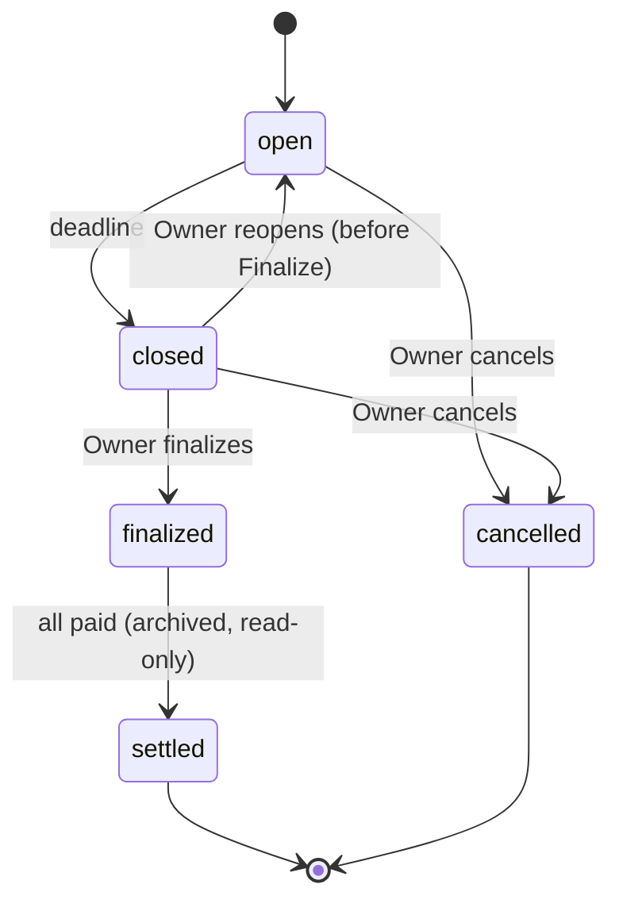

# Jay's Badminton — Technical Design

> Living version: https://claude.ai/code/artifact/512d46a5-9d24-4344-a00b-7fb93107a631 — this file is an exported snapshot. Requirements (Chinese): [requirements.zh.md](requirements.zh.md).

Oct 1, 2026 · @Ke Li

The whole system runs on Cloudflare's free tier at jaysbadminton.llmat.dev: Workers serves the pages and API, D1 stores the data, Cron Triggers run reminders, and Email Routing receives forwarded Venmo emails for instant payment matching. A small Google Apps Script mirrors the data into a Google Sheet once a day. This document implements the requirements document (Chinese) without changing its rules.

## Architecture


One Cloudflare Worker serves the pages and API, receives forwarded Venmo emails and runs the 10-minute cron; all of them share one D1 database. Telegram alerts come from both the cron job and the email handler. Google sees only the forwarded Venmo emails and the daily export the Sheet pulls.

## URLs and routing

One Worker answers everything on `https://jaysbadminton.llmat.dev`: page paths return the single-page app, `/api/*` returns JSON. All pages are Chinese and mobile-first.

| Path | Audience | What it shows |
| --- | --- | --- |
| `/` | Public | Open and recent events, past events, attendance leaderboard, link to join |
| `/join` | Public | Join request form (username, WeChat nickname) |
| `/e/{code}` | Public | One event: time, place, deadline, headcount, roster, attendance after Finalize |
| `/m/{memberToken}` | Member | Sign-up with friends, rename, amounts owed + Venmo button, personal stats |
| `/admin/{adminToken}` | Owner | Approvals, members, events, roster edits, settlement, payment board, 待确认 Venmo payments, settings, exports |
| `/api/...` | Mixed | JSON API (see API) |
| `/export/...` | Owner (export key) | CSV downloads and the JSON feed for the Google Sheets mirror |

- `{code}` is the event code from the requirements: the event date as MMDD (`1006`), with a letter suffix for a second event on the same day (`1006B`). Codes are unique among events that are not archived; the public page resolves the newest matching event.
- Unknown or revoked tokens show a neutral "链接无效，请联系管理员" page with no detail.
- Pages send `Cache-Control: no-store` and `Referrer-Policy: no-referrer` so tokens are not cached or leaked to Venmo or other sites.

## Identity and security

Members have no passwords: their identity is the secret token in their link, delivered privately over WeChat. The Owner's admin page needs its own link plus a password.

- **Tokens**: 32 random bytes from `crypto.getRandomValues`, base64url (43 characters). D1 stores a SHA-256 hash for lookup plus the token encrypted with AES-GCM under a key held as a Worker secret (TOKEN\_KEY). Exports and the Sheets mirror never include either column.
- **Showing a link again**: the admin page decrypts the stored token to show the member's link and QR code again, as the requirements ask. **Regenerate** issues a new token and the old one stops working at once.
- **Admin token**: a separate token for `/admin/{token}`, plus a password. The first visit to `/admin` (while no admin link exists) asks for the password and creates the admin link and the Owner's member record. A lost link is reset by running the deploy workflow with `reset_admin_link` (on the latest release tag for production, on `main` for the test site, whose password is `ADMIN_PASSWORD_STAGING`), which reopens first-time setup. The admin API needs both the link and a session cookie (HttpOnly, Secure, SameSite=Strict, path `/api/admin`, 30 days) obtained with the password. The password hash is PBKDF2-SHA256 over an HMAC peppered with `TOKEN_KEY`, with few iterations to fit the 10 ms CPU limit. Changing it in settings signs every device out. The `ADMIN_PASSWORD` GitHub secret is pushed to the Worker on every deploy; when its value changes, the stored hash resets to it and all sessions end (the forgotten-password path). `TOKEN_KEY` is generated once by CI and never replaced
- **Export key**: a third independent token for `/export/*`, used by the CSV links and the Apps Script mirror. Regenerable from settings.
- **Member IDs**: `M001`, `M002`, … assigned on join request, never reused or changed. Used in payment codes and as the stable key everywhere.
- **Authorization**: every API handler resolves the token first and only reads or writes rows for that member; the Owner token unlocks admin endpoints. Deactivated members' tokens are rejected.
- **Abuse limits**: `/join` and token lookups are rate-limited per IP with Cloudflare's free rate-limiting rule; the join form has a hidden honeypot field. Usernames are unique case-insensitively and limited to 20 characters.
- **Secrets** (Telegram bot token, export key hash, etc.) live in D1 settings or Worker secrets (`wrangler secret put`), never in the repository.
- **Known accepted risk**: anyone holding a member link can act as that member (as stated in the requirements).

## Data model

D1 (SQLite) holds nine tables. Money is stored as integer cents, times as UTC ISO strings and shown in America/Los\_Angeles. Schema changes ship as numbered migrations in `migrations/`.

| Table | Key columns | Notes |
| --- | --- | --- |
| `members` | `id` (M001), `username` (unique, NOCASE), `wechat_nickname`, `status` (pending / active / inactive), `token_hash`, `token_enc`, `is_owner`, `requested_at`, `approved_at` | Rejected requests are deleted; the next ID is never reused |
| `events` | `id`, `code` (1006, 1006B), `date`, `start_at`, `end_at`, `location`, `deadline_at`, `deadline_offset_min`, `status` (open / closed / finalized / settled / cancelled), `finalized_at`, `settled_at`, `dunning_stopped`, `created_at` | `settled` = all paid and archived; read-only from then on |
| `registrations` | `id`, `event_id`, `member_id`, `friend_index` (0 = the member), `friend_name`, `attended` (default 1), `added_by_owner`, `created_at`, `updated_at` | Friends hang off the member who pays for them; Owner-added walk-ins ignore the friend cap |
| `settlements` | `event_id`, `court_total_cents`, `shuttle_count`, `shuttle_price_cents`, `registered_count`, `attended_count`, `court_share_cents`, `shuttle_share_cents`, `finalized_at` | One row per event; recomputed on every edit before archive |
| `payments` | `event_id`, `member_id`, `amount_due_cents`, `payment_code` (xiaoming-jbm20261006-m007), `status` (unpaid / partial / paid), `amount_paid_cents` (sum of receipts), `refunded_cents`, `paid_at` | One row per paying member per event; friends roll up here |
| `payment_receipts` | `payment_id`, `amount_cents`, `method` (venmo / manual), `venmo_txn_id` (unique), `payer_name`, `received_at` | Every payment toward a bill; a bill can be paid in several pieces |
| `inbound_payments` | `venmo_txn_id` (unique), `email_id`, `payer_name`, `amount_cents`, `note`, `received_at`, `kind` (unmatched = 待确认), `state` (open / linked / ignored), `linked_payment_id`, `reason` | Venmo payments with our code that the Owner reviews; unrelated payments are not stored |
| `locations` | `name`, `last_used_at`, `use_count` | Feeds the location dropdown |
| `settings` | `key`, `value` | Friend cap N, Venmo username, Zelle account, Telegram chat ID, reminder on/off + hours, dunning hour, last shuttle price, last event times, last deadline offset, admin/export token hashes |
| `notification_log` | `event_id`, `type`, `sent_on` (Pacific date), `sent_at` | Unique on (event, type, sent\_on) so a retried cron run never double-sends |

Payments for the Owner and the Owner's friends are created as `paid` with method `manual` at Finalize. The "collected" check counts rows that are not `paid`; it never compares totals.

## API

JSON over HTTPS under `/api`, grouped by who may call it. Tokens travel in the path segment the page already has, never in query strings. Writes are POST; all inputs are validated server-side.

| Audience | Endpoints |
| --- | --- |
| Public | `GET /api/public/home` (open events, past events, leaderboard) · `GET /api/public/events/{code}` · `POST /api/public/join` |
| Member (`/api/m/{token}/…`) | `GET me` (profile, open events, my registrations, my payments, my stats) · `POST rename` · `POST events/{id}/register` (friend count + names) · `POST events/{id}/cancel` |
| Owner (`/api/admin/{token}/…`) | Members: `GET members`, `POST members/{id}/approve`, `reject`, `regenerate`, `deactivate` · Events: `POST events`, `POST events/{id}/cancel`, `reopen`, roster `add` / `update` / `remove` · Settlement: `POST events/{id}/preview`, `finalize`, `attendance` · Payments: `POST payments/{id}/mark-paid`, `refunded`, `POST receipts/{id}/remove`, `POST events/{id}/dunning`, `GET inbound`, `POST inbound/{id}/link`, `ignore` · Telegram: `GET telegram`, `POST telegram/connect`, `test`, `disconnect` · Settings: `GET/POST settings`, `POST settings/password`, `rotate-admin`, `reset`, `rotate-export` |
| Export (`/export/{key}/…`) | `GET all.json` (Sheets mirror) · `GET {table}.csv` |

- Every Owner write on an event checks its status first: roster and settlement edits are refused once the event is `settled`, matching "archived means read-only".
- Errors return `{ error: { code, message } }` with a Chinese `message` the page shows as-is.

## Event lifecycle



Status changes happen in one module (`events/transition.ts`) that refuses illegal moves, so the archive lock cannot be bypassed by any endpoint. `closed` is set by the cron job at the deadline; `settled` is set the moment the last unpaid payment flips to paid. Once an event has ended without Finalize, the Owner gets an hourly reminder. Stopping dunning sets a flag on a `finalized` event and does not change its status.

## Settlement and payment codes

Settlement is one pure function, `settle(roster, inputs)`, shared by preview and Finalize and covered by unit tests, including the example from the requirements (24 registered, 22 attended, $240 courts, 20 shuttles at $3 → $12.73 and $10.00).

```latex
\text{court share} = \left\lceil \frac{\text{court total}}{\text{registered}} \right\rceil_{\text{cent}} \qquad \text{shuttle share} = \left\lceil \frac{\text{shuttles} \times \text{price}}{\text{attended}} \right\rceil_{\text{cent}}
```

1. Count every roster row (members and friends) as registered; count rows with `attended = 1` as attended.
2. Work in integer cents and round each share **up** with integer math (`Math.ceil(a / b)` on cents), so floating point never under-charges.
3. Each row owes the court share, plus the shuttle share if attended. A member owes the sum of their own row and their friends' rows.
4. On every change before archive, recompute `amount_due_cents` for rows still `unpaid` or `partial` (then their status from the receipts); leave `paid` rows untouched.

**Payment code**: `{name}-jbm{yyyymmdd}{suffix}-m{number}`, all lowercase, e.g. `xiaoming-jbm20261006-m007` (a second event that day gets `jbm20261006b`). The name is the username in toneless pinyin (pinyin-pro) or lowercase Latin with spaces as underscores. It is generated at Finalize and never changed by renames. Only the `jbm` and `m` parts are matched, so the name is cosmetic; the earlier `BM1006-M007` form is still recognised.

**Venmo button**: a link to `https://venmo.com/{owner}?txn=pay&amount={amount}&note={code}` (the current web pay link; the exact format is verified on a real phone before launch, since Venmo has changed it before). The page also prints the username, amount and code as plain text, the Zelle account, and the hint to open in the system browser when WeChat blocks the link.

## Venmo email ingestion

A Gmail filter forwards only mail from `venmo@venmo.com` to `venmo@jaysbadminton.llmat.dev`; Cloudflare Email Routing hands each message to the Worker's `email()` handler, which matches it within seconds. The Worker never has access to the Owner's mailbox.

1. **Accept or drop**: the From address must be `venmo@venmo.com` and the subject must read `… paid $X.XX to your Venmo account`; anything else is dropped silently (never bounced). The Worker then verifies Venmo's own DKIM signature itself (`d=venmo.com`, rsa-sha256, From, To and Subject signed, exactly one of each, no `l=`), fetching the public key over DNS-over-HTTPS (Cloudflare, falling back to Google). Gmail forwarding and Email Routing only add headers on top, so the signature survives; this was checked against a real forwarded receipt. A forged "Venmo" email sent straight to the address fails here and is dropped. If DNS is unreachable the email is never auto-marked (see step 4).
2. **Parse** the HTML body (Venmo receipts carry an empty text part): HTML is flattened to lines, then the field rules in the requirements apply: payer before `paid you`, the amount after it (Venmo splits `$7.00` across several elements, so the pieces are joined and cross-checked against the subject), note up to `Money credited to your Venmo account.`, then the `Date`, `Transaction ID` and `Sent to` values. `Sent to` must equal the configured Venmo username and the signed `To` header must be exactly the configured Venmo notification email (the address on the Venmo account; required together with the username in settings), otherwise the email is ignored. `Delivered-To` is not used: Gmail adds it and it is not signed.
3. **De-duplicate** on the Venmo transaction ID; a second copy is ignored.
4. **Match**: the Owner forwards every Venmo receipt, most unrelated to badminton, so only notes matching `/([a-z0-9_]+)\s*-\s*jbm\s*(\d{8})([a-z]?)\s*-\s*m(\d+)/i` whose name part belongs to a group member (current username in pinyin, or the name printed on any bill) and whose date + suffix is an existing event are acted on:
   - the member has a bill on that event and the name is the one printed on the bill (fixed when the bill is created; renames do not change it) → add a `payment_receipts` row (amount, transaction ID, payer) and recompute the bill: total < due → `partial`, total ≥ due → `paid` (run the "all collected?" check), total > due → the excess is listed under 需要退款 until the Owner marks it refunded. This also applies to archived events, which can only gain an over-payment;
   - the event exists but the bill cannot be pinned down (no bill for that member number, name and number are different people, event not settled yet, cancelled, or already archived) → `inbound_payments` kind `unmatched` with a reason, shown under 待确认, notify the Owner;
   - anything else (no code, no name, unknown name or event, unparseable email) → ignored and not stored.
   - If DNS was down and the signature could not be checked, an email that would otherwise be acted on goes to 待确认 instead; it is never auto-marked.

The admin page's 收款 tab lists the 待确认 rows with their reason; the Owner links one to an open bill (marks it paid with that amount) or ignores it.

**Gmail forwarding confirmation**: while the Owner adds the forwarding address, Email Routing temporarily forwards that address to the Owner's Gmail so Google's confirmation link arrives; the route is switched to the Worker before the Gmail filter is created, avoiding a forwarding loop. The sample email from the requirements becomes the first parser test fixture.

## Scheduled jobs and Telegram notifications

One Cron Trigger runs every 10 minutes (`*/10 * * * *`, UTC); the handler converts "now" to Pacific time and walks every non-archived event. Each notification is written to `notification_log` before sending, so a retry never sends twice.

| Job | Fires when | Repeats |
| --- | --- | --- |
| Deadline reminder | `deadline_at − reminder hours ≤ now < deadline_at`, reminders on, event created before that window | Once per deadline (again after a reopen) |
| Close sign-up | `now ≥ deadline_at` and status `open` → status `closed`, send roster summary | Once per deadline |
| Settle reminder | `now ≥ end_at` and not finalized | Hourly (log key = Pacific date + hour) |
| Daily dunning | `now ≥ finalized_at + 24 h`, local hour = dunning hour, someone unpaid, dunning not stopped | Daily: one summary + one message per unpaid member |
| All collected | Triggered inline whenever a payment flips to paid (email or manual) and none remain | Once, then the event is archived |
| Payment needs review | Inline from the email handler (待确认, partial payment, over-payment to refund) | Per email |

**Telegram**: `POST https://api.telegram.org/bot{token}/sendMessage` to the Owner's chat ID with `parse_mode: HTML`. Each message has the Owner's details first, then a divider and the text to paste into WeChat inside a `<pre>` block so one tap copies it. Per-person dunning messages are separate Telegram messages so each can be forwarded to a private chat on its own. The bot token is a Worker secret (`TELEGRAM_BOT_TOKEN`, from the GitHub secret of the same name); the chat ID is a setting. A failed send removes its log row so the next run retries.

**Binding the Owner's chat**: 设置 → 连接 Telegram calls `getMe` and `setWebhook` (`/api/telegram/webhook`, with a `secret_token` derived from `TOKEN_KEY` that Telegram echoes in `X-Telegram-Bot-Api-Secret-Token`), then returns `t.me/<bot>?start=<code>`. The code is random, stored hashed, single-use and valid for 10 minutes. The webhook acts only on `/start <valid code>` from a private chat, which stores that chat as the only recipient; everything else is ignored. Settle reminders are quiet from 22:00 to 08:00 Pacific.

**Admin link recovery**: the admin token is stored hashed and AES-GCM encrypted under `TOKEN_KEY`. 「管理页面」 or `/admin` from the bound chat (and only that chat) gets the current link; a link issued before encryption existed is replaced by a new one. **Gmail forwarding confirmation**: mail from `forwarding-noreply@google.com` with a valid google.com DKIM signature is passed to the Owner's Telegram, so the Owner can confirm the forwarding address without help. The last Venmo/Gmail email's time and outcome are kept in settings and shown in the admin guide as 转发状态.

## Address suggestions

The venue form's 地址 field asks our own endpoint (`GET /api/admin/{token}/places?q=`), so no key reaches the browser. With the `GOOGLE_MAPS_API_KEY` secret set it uses Google Places (New) Autocomplete, restricted to the US and biased to Northern California (36°–42°N, 124.5°–119°W); picking a suggestion fetches only `formattedAddress` with the same session token, so a whole search is billed as one session and stays within Google's free monthly calls. Without the key, or if Google refuses (quota, key problem), it falls back to Photon (OpenStreetMap): Northern California first, then the rest of the US. The page waits 250 ms after typing, shows 搜索中…, and caches repeated queries.

## Appearance

Two styles (`minimal`, `aurora`) × four accents each, light and dark. `src/shared/themes.ts` lists them as `style-accent` ids (`minimal-coral` is the default); `styles.css` keys every colour off `data-style`, `data-accent` and `data-mode` on `<html>`. The Owner's choice is the `theme` setting (old palette names map to the nearest new id). A visitor's own choice and their light/dark/auto mode live only in `localStorage` (`my-theme`, `my-mode`); `index.html` applies them before first paint. Colours are plain values or `rgba(var(--triplet), a)` — no `color-mix()` — so older WeChat WebViews render them. Fonts: Geist and Geist Mono (Latin only, bundled); Chinese uses the system font.

## Health alerts and weekly digest

`src/worker/health.ts`. Every Venmo email outcome is logged in `email_log` (outcome and time only; pruned after 120 days). A parse failure, a bad signature or a wrong recipient alerts the Owner at once (once a day per kind). At the bill-reminder hour the cron checks for a quiet spell: bills out ≥ 3 days, no Venmo email for ≥ 3 days → one alert per spell (keyed by the last email time). On Mondays at that hour it sends the weekly digest (switchable, setting `weekly_digest`). A scheduled run that throws records `cron_last_error[_at]` for the digest. Site-wide notices use `event_id = 0` in `notification_log`, since NULL would not de-duplicate.

## Link previews, calendar and icon

The Worker runs first for `/` and `/e/*` (`run_worker_first`), fetches the app shell from `ASSETS` and rewrites `<title>`, `description` and `og:*` with HTMLRewriter (`src/worker/share.ts`): event title, date, time, venue, headcount, deadline — never names. `GET /api/public/events/{code}/calendar.ics` serves an RFC 5545 file (UTC times, folded lines, 2-hour alarm); the page also links a prefilled Google Calendar URL (`src/shared/calendar.ts`). Icons, `manifest.webmanifest` (no `start_url`, so a member's home-screen shortcut opens their own page) and the share image live in `src/web/public`.

## Google Sheets daily mirror

The site never logs into Google. 设置 → Google 表格同步 → 开启同步 creates an export key (stored hashed to check requests, and AES-GCM encrypted under `TOKEN_KEY` so the page can show the script again) and shows a ready-to-paste Apps Script with the site address and key filled in (`src/worker/sheets.ts`). The Owner pastes it into the sheet's Apps Script editor and runs `install` once.

- **Pull**: `sync()` fetches `GET /export/{key}/all.json` and rewrites one tab per table (成员, 活动, 报名, 结算, 应付款, 付款明细, 待确认收款, 场馆), header row frozen and bold, plus a 同步记录 tab with one line per run. Edits in the sheet never flow back.
- **Trigger**: `install()` replaces any previous trigger with one daily run at 03:00 America/Los_Angeles, then syncs once.
- **History**: Google Sheets keeps version history (文件 → 版本记录), so each day's sync can be looked up there; D1 Time Travel covers the last 7 days on the Cloudflare side.
- **Key**: 重新生成密钥 replaces the key immediately (the old script gets 403 and says so); 关闭同步 deletes it. The admin page shows the last time the sheet pulled.
- **Permissions**: the script asks for "see and edit this spreadsheet", "connect to an external service" and "run when you are not present"; no Gmail or Drive scope. The Owner sees Google's unverified-app warning once and continues via 高级.
- **Content**: the same people-friendly tables as the CSV downloads (`src/worker/export.ts`): Chinese headers, dollars, Pacific times, event numbers like `jbm20261007b`. Tokens, hashes and settings are never exported.

**CSV downloads**: 设置 → 导出数据 offers each table as a UTF-8 CSV with a BOM (so Excel shows Chinese correctly); cells starting with `= + - @` are prefixed so spreadsheets do not run them as formulas.

**Statistics** (`src/worker/stats.ts`): attendance follows the Owner's 到场 marks on finalized or archived events. The public leaderboard (members only, no money) ranks this year's attendance, the longest run of consecutive events attended, and friends brought this year. The member page shows this year's and all-time visits, this year's spending (their bills, friends included), the average per visit, and the same period last year.

## Repository, tooling and deployment

One TypeScript repository (`likefudan/jaysbadminton`) builds one Worker that serves both the static front end and the API; every merge to `main` deploys the test site (`env.staging`: Worker `jaysbadminton-staging`, its own D1 and domain `staging.jaysbadminton.llmat.dev`, its own Telegram bot); production deploys only from a `v*` release tag on `main`, after exporting its database.

| Part | Choice | Why |
| --- | --- | --- |
| Runtime | Cloudflare Workers with static assets | Pages, API, cron and email in one deployable |
| Router | Hono | Small, typed, built for Workers |
| Database | D1 + SQL migrations via Wrangler | Free, SQLite, versioned schema |
| Front end | Preact + Vite, Chinese UI, no CSS framework, self-hosted Geist fonts | Small bundle for slow WeChat in-app browsers |
| QR codes | `qrcode` npm package, rendered in the browser | Owner long-presses to save, as required |
| Email parsing | `postal-mime` | Standard MIME parser for Email Workers |
| Tests | Vitest + `@cloudflare/vitest-pool-workers`; Playwright browser tests (`e2e/`) | Unit/integration against a real local D1; browser tests drive the main flows on a local Worker with a fresh database (`scripts/e2e-server.sh`) |
| CI/CD | GitHub Actions: typecheck, test, build, browser tests; `main` → staging, `v*` tag → production (tag-on-main check, D1 export artifact, migrations, deploy, secret sync, smoke test); re-running on an older tag rolls back; Dependabot opens monthly grouped update PRs | Uses a `CLOUDFLARE_API_TOKEN` repository secret |

```text
docs/            requirements (Chinese) and this design
migrations/      D1 schema, numbered SQL files
src/worker/      Hono API, cron handler, email handler, settlement, Telegram
src/web/         Preact pages: home, join, event, member, admin
test/            unit + integration tests, Venmo email fixtures
wrangler.toml    bindings: DB, ASSETS, cron, secrets
```

**Test focus**: settlement math and rounding, status transitions and the archive lock, deadline/reminder timing across daylight-saving changes, payment-code matching, and the Venmo parser against real (redacted) emails.

**Environments**: local development with `wrangler dev` and a local D1; production only. A staging Worker can be added later if needed.

## Free-tier budget

Expected use is a few hundred requests a day, far inside Cloudflare's free plan. The limits below were checked against the Cloudflare Workers and D1 limits and pricing pages on 2026-10-01. The one that shapes the code is 50 D1 queries per invocation: handlers batch their statements.

| Resource | Free limit | Expected use |
| --- | --- | --- |
| Worker requests | \~100,000 / day | A few hundred / day, plus 144 cron runs |
| CPU per invocation | \~10 ms | Low single-digit ms for API calls, settlement and email parsing |
| Cron Triggers | \~5 per account | 1 |
| D1 storage | 5 GB total, 500 MB per database | Under 1 MB per year |
| D1 reads / writes | \~5M rows read, \~100k rows written per day | Thousands at most |
| D1 Time Travel | \~7 days of point-in-time restore | Backup; daily Sheets snapshots add 30 days |
| Email Routing | Free; each email runs the Worker | A few dozen emails / week |
| Static assets | Not billed as Worker requests | All page loads |

On the free plan, exceeding a limit makes requests fail rather than adding charges, so there is no surprise bill. The only paid item is the domain, which the Owner already has.

## Owner setup checklist

The Owner does these once, in this order; steps marked *after deploy* wait until the Worker is live.

- [x] Enable Email Routing for the `jaysbadminton.llmat.dev` subdomain and verify the Gmail destination
- [x] Create `venmo@jaysbadminton.llmat.dev`, temporarily forwarding to Gmail
- [ ] Add that address as a Gmail forwarding address, confirm it, and keep "Disable forwarding" selected
- [x] Create a Telegram bot with BotFather and add its token as the GitHub secret `TELEGRAM_BOT_TOKEN`
- [ ] Create a Cloudflare API token (Workers, D1, DNS edit) and add it to the GitHub repository as `CLOUDFLARE_API_TOKEN`
- [ ] *After deploy*: add the `jaysbadminton.llmat.dev` custom domain to the Worker
- [ ] *After deploy*: open `https://jaysbadminton.llmat.dev/admin`, enter the `ADMIN_PASSWORD`, and save the admin link it shows (the Owner signs up from the admin page); later, set the `TELEGRAM_BOT_TOKEN` Worker secret (card 6)
- [ ] *After deploy*: in the admin settings, enter the Venmo username, Venmo email and Zelle account; press 连接 Telegram, tap Start in the bot, then 发送测试消息
- [ ] *After deploy*: switch the `venmo@` route from "Send to an email" to "Send to a Worker"
- [ ] *After deploy*: create the Gmail filter `from:venmo@venmo.com` → forward to `venmo@jaysbadminton.llmat.dev`
- [ ] *After deploy*: 设置 → Google 表格同步 → 开启同步; create a Google Sheet, paste the shown script into Apps Script, run `install` once
- [ ] Test end to end: a test event where one member pays the exact amount with the payment code shows as paid within a minute
